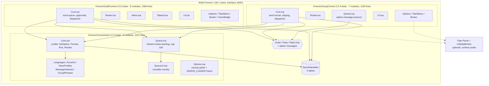
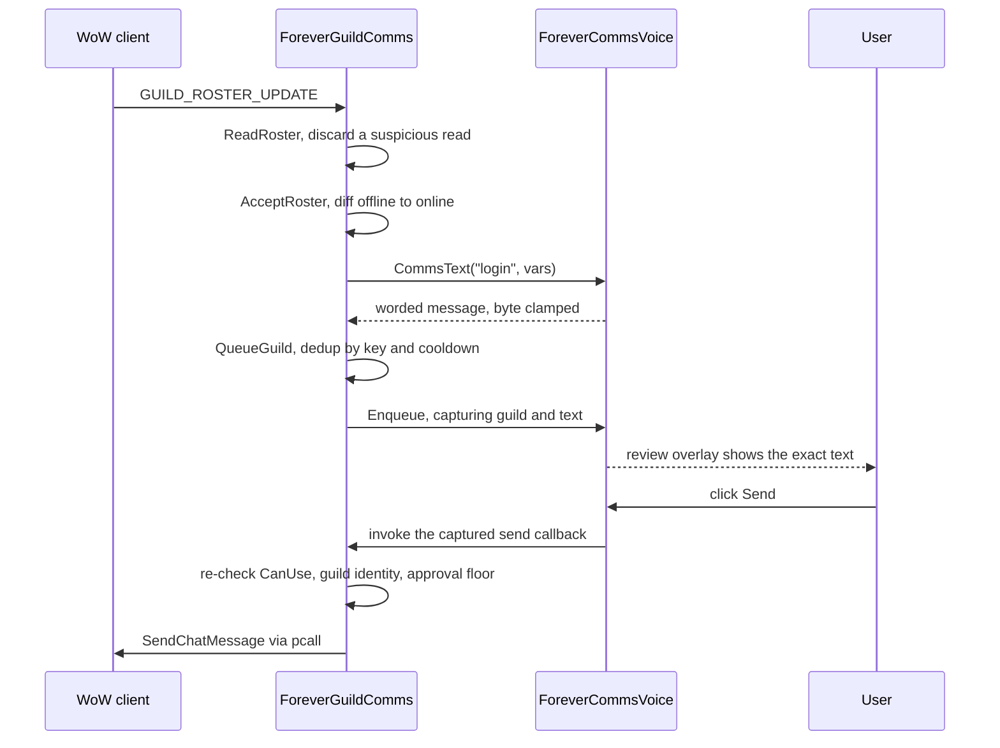
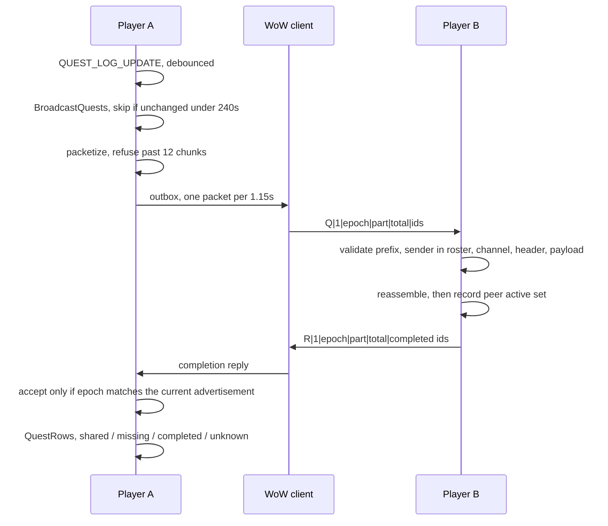

# System Architecture

**Target**: ForeverCommsVoice 0.2.2-beta, ForeverGroupComms 0.3.4-beta, ForeverGuildComms 0.6.3-beta
**Analysis date**: 2026-10-25T02:30:00Z
**Target commit**: `a64ac2a`

## System Overview

Three World of Warcraft addons shipped from one repository as a bundle. One is a shared
library; the other two are applications that depend on it. Everything runs in-process
inside the WoW client. There is no server, no network service beyond the game's own chat
transport, and no persistence other than Blizzard's SavedVariables files.

The architectural spine is a **single shared library with two consumers**, where the
library owns two cross-cutting capabilities that would otherwise be duplicated: how a
message is *worded*, and the backlog of messages *awaiting a click*. Both consumers own
when and whether a message is delivered; the library never sends anything.

## Architecture Diagram

## Component Descriptions

### ForeverCommsVoice

- **Purpose**: own every decision about how an addon-generated message is worded, and own
  the single backlog of messages awaiting user approval.
- **Responsibilities**: the per-character voice profile and its sole validating writer;
  8 languages; 29 accent phrasebooks; the race-to-accent map; the guild and group phrase
  catalogs; shuffle bags; the `V:Render` pipeline with per-scope resolvers; the 250-byte
  UTF-8 clamp; the review queue with its 100-entry bound, per-record expiry and movable
  overlay.
- **Dependencies**: none. It is the root of the dependency graph.
- **Type**: Shared library / Models.
- **Does not**: send chat, read chat, register for combat or roster events, or take any
  automatic action. Consumers own delivery.

### ForeverGuildComms

- **Purpose**: the guild-facing social layer.
- **Responsibilities**: roster diffing for login and level transitions; the guild send
  queue with spacing; automatic-versus-review delivery; the approval backlog and its
  floor; private craft and LFG alerts parsed from guild chat only; the learned-recipe
  cache; tabard reminders; the Ask-for-Help composer; a nested Titan menu; three
  keybindings.
- **Dependencies**: `ForeverCommsVoice` (hard, via TOC). Titan/LibDataBroker (optional).
- **Type**: Application.

### ForeverGroupComms

- **Purpose**: the party and dungeon layer.
- **Responsibilities**: group scanning and `groupSerial` identity stamping; greetings and
  level congratulations staged for review; coordination calls; native ready checks with a
  private response tally; target marking behind a rank gate; the bidirectional quest
  comparison protocol with its paced outbox; manual quest sharing; a nested Titan menu;
  three keybindings.
- **Dependencies**: `ForeverCommsVoice` (hard, via TOC). Titan/LibDataBroker (optional).
- **Type**: Application.

## Data Flow

### Staged guild greeting, reviewed and sent

### Quest comparison between two addon users

## Integration Points

- **External APIs**: none. No HTTP, no sockets, no cloud services.
- **Databases**: none. Four Blizzard SavedVariables tables, serialized by the client.
- **Third-party Services**: none at runtime. GitHub Actions and BigWigsMods/packager
  participate only at release time.
- **Game transport**: `SendChatMessage` for the three chat channel families, and
  `C_ChatInfo.SendAddonMessage` under the 15-byte prefix `ForeverGrpComms` for quest sync
  only.

## Event architecture

**One dispatcher per addon.** Each registers its events on a single frame, gates on
`if not A.initialized then return end`, and routes to module methods through existence
checks so a module can be absent.

| Addon | Dispatcher location | Events | Init trigger |
| --- | --- | --- | --- |
| ForeverCommsVoice | `Options.lua`, bottom | 1 — `ADDON_LOADED` | `ADDON_LOADED` matching `V.name` |
| ForeverGuildComms | `Core.lua`, bottom | 14 | `PLAYER_LOGIN` |
| ForeverGroupComms | `Core.lua`, bottom | 10 | `ADDON_LOADED` matching the vararg |

Voice's dispatcher living in `Options.lua` rather than `Core.lua` is a known deviation
from the project's own structure rule, recorded in `.kiro/steering/structure.md`. It is
also where the `ADDON_LOADED` registration defect fixed this span had been hiding: the
handler compared the event's addon name against a bare `ADDON`, which is nil in any file
following the `local _, V = ...` pattern, so the Settings panel was never registered
until the user ran `/fcv`.

## Infrastructure Components

- **CDK Stacks**: none.
- **Deployment Model**: file copy into `Interface\AddOns`. Four installers — one combined
  at the repository root plus one per package — parse their own TOC, copy only listed
  loadable files plus `Bindings.xml` and GuildComms' icon, back up what they replace under
  `Interface\AddOnBackups`, and never touch WTF or SavedVariables. The combined installer
  prepends `ForeverCommsVoice` to any selection naming a consumer, so a dependency-less
  install is unreachable rather than merely warned about.
- **Networking**: none.

## Architectural invariants

These are the properties the design depends on, and all of them are now asserted by
harnesses:

1. **The library never sends.** It words messages and holds a backlog; consumers deliver.
2. **One validating writer per setting.** `V:SetOption` owns the shared profile;
   `A:SetOption` owns GuildComms' settings. Panels and menus route through them.
3. **The shared voice profile has exactly one owner.** `A.char.voice` and
   `ForeverCommsVoiceCharDB.voice` are the same table at runtime, so neither consumer may
   write it directly — including from Restore Defaults.
4. **Identity is stamped, then re-checked at send time.** `groupSerial` for groups,
   the guild name for guilds. A message staged for one group or guild can never reach
   another.
5. **Bounds refuse rather than corrupt.** Caps decline work or drop the oldest, and a
   dropped entry's callback is never invoked.
6. **A missing client API denies.** Rank checks and feature probes fail closed.
