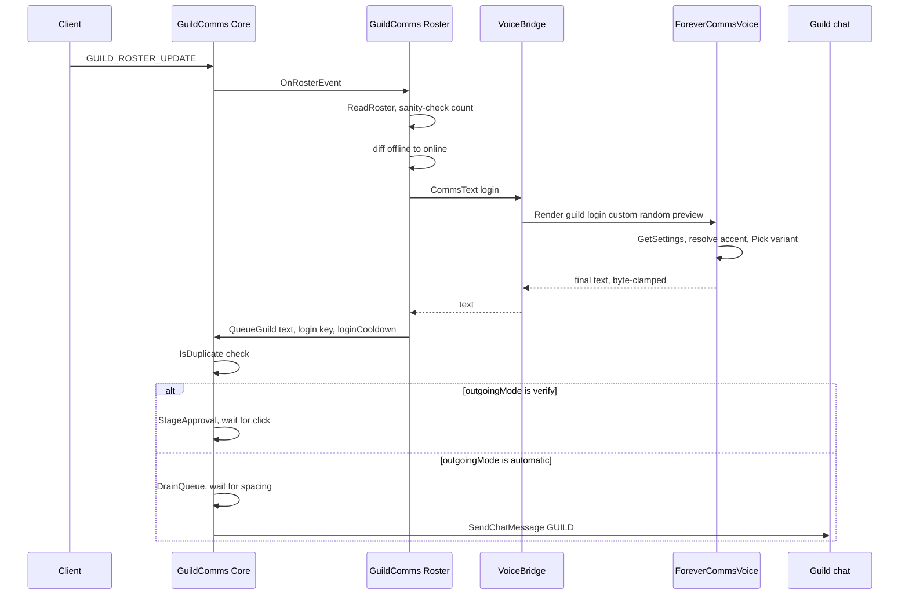
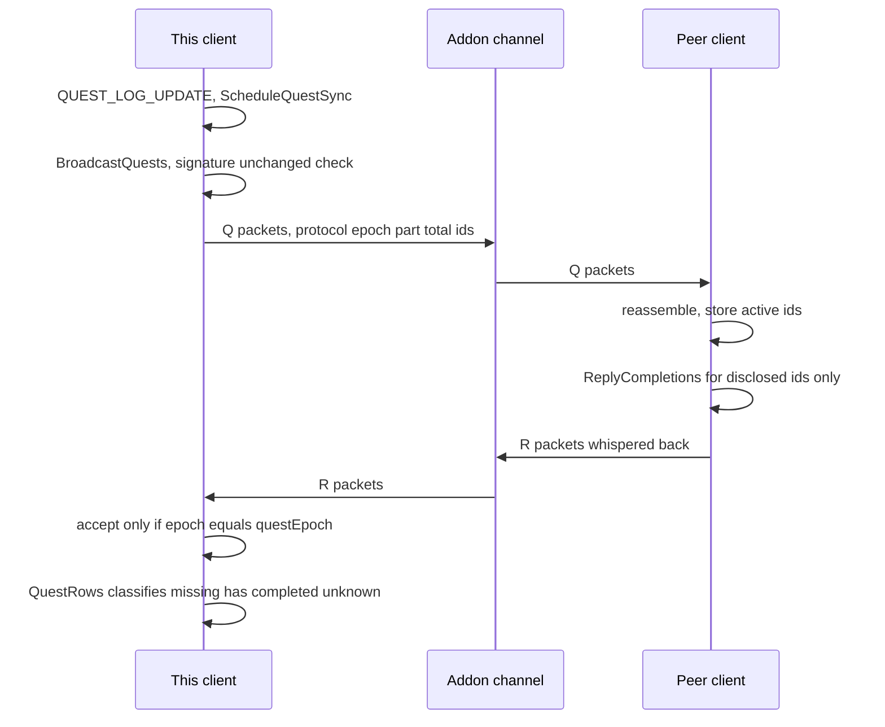

# System Architecture

**Analysis date**: 2026-10-19T13:30:00Z
**Target**: ForeverCommsVoice 0.2.1-beta, ForeverGroupComms 0.3.3-beta, ForeverGuildComms 0.6.2-beta
**Workspace root**: `c:\Program Files (x86)\World of Warcraft\_classic_beta_\Interface\Addon-Manual\ForeverCommsBundle-Development`

## System Overview

Three World of Warcraft Forever addons in one Git repository, loaded by the client as
three independent AddOns folders. There is no compiler, no bundler, no package manager
and no server component. Each addon is a flat list of Lua 5.1 files loaded in TOC order
into a per-addon vararg namespace.

The architecturally significant change in this pass is the introduction of a **shared
library addon**. Previously ForeverGuildComms was a single self-contained package whose
only external coupling was an optional runtime probe for LibDataBroker. There are now
three packages and a real, declared, hard dependency edge:

```
ForeverCommsVoice  (library, no dependencies)
      ^                    ^
      | ## Dependencies    | ## Dependencies
ForeverGuildComms    ForeverGroupComms
```

The dependency is enforced at three levels: the client refuses to load a dependent addon
whose `## Dependencies:` entry is missing; GuildComms' `VoiceBridge.lua` calls `error()`
on load if `_G.ForeverCommsVoice` is absent; GroupComms degrades gracefully instead,
falling back to its own English table when the global is missing or `useSharedVoice` is
off.

Cross-addon communication is through **plain globals**, not a library framework. There is
no LibStub registration, no version negotiation and no embedded library. Voice publishes
`_G.ForeverCommsVoice` from `Core.lua`; GuildComms publishes `_G.ForeverGuildComms`;
GroupComms publishes `_G.ForeverGroupComms`. Voice calls back into GuildComms by global
probe when a shared setting changes.

## Architecture Diagram

```mermaid
flowchart TB
    subgraph VoicePkg["ForeverCommsVoice 0.2.1-beta - 9 modules, 1207 lines"]
        VCore["Core.lua<br/>profile, migration, Format,<br/>Pick, Render, RegisterCatalog"]
        VLang["Languages.lua<br/>8 languages, locale templates,<br/>role and activity labels"]
        VAcc["Accents.lua<br/>29 accent phrasebooks"]
        VRace["RaceProfiles.lua<br/>race map, accent resolution,<br/>legacy VoiceText"]
        VVar["MessageVariants.lua<br/>locale and accent variants,<br/>ChooseMessageTemplate"]
        VGroup["GroupPhrases.lua<br/>group catalog, group accent<br/>variants, RegisterCatalog calls"]
        VOpt["Options.lua<br/>/fcv panel, ADDON_LOADED frame"]
    end

    subgraph GuildPkg["ForeverGuildComms 0.6.2-beta - 9 modules, 1491 lines"]
        GCore["Core.lua<br/>defaults, queue, approvals,<br/>dedup, slash, 14-event frame"]
        GBridge["VoiceBridge.lua<br/>25-line adapter to Voice"]
        GRoster["Roster.lua"]
        GAlerts["Alerts.lua"]
        GTabard["Tabard.lua"]
        GUI["UI.lua"]
        GOpt["Options.lua"]
        GTitan["TitanMenu.lua"]
        GBroker["Broker.lua"]
        GBind["Bindings.xml<br/>auto-loaded, not in TOC"]
    end

    subgraph GroupPkg["ForeverGroupComms 0.3.3-beta - 7 modules, 1108 lines"]
        PCore["Core.lua<br/>defaults, Render with fallback,<br/>Send, Stage, 10-event frame"]
        PRoster["Roster.lua<br/>roster, roles, ready check"]
        PQuests["Quests.lua<br/>Q and R protocol, comparison"]
        PUI["UI.lua<br/>panel and quest windows"]
        POpt["Options.lua"]
        PBroker["Broker.lua"]
        PBind["Bindings.xml<br/>auto-loaded, not in TOC"]
    end

    GBridge -->|"_G.ForeverCommsVoice"| VCore
    PCore -->|"V:Render group"| VCore
    VCore -.->|"RefreshOptions probe"| GCore
    VGroup --> VCore
    VLang --> VCore
    VAcc --> VRace
    VVar --> VCore

    GBroker -.->|"LibStub optional"| LDB["LibDataBroker-1.1<br/>from Titan Panel"]
    PBroker -.->|"LibStub optional"| LDB
    GTitan -.->|"MenuUtil optional"| MenuAPI["Blizzard MenuUtil"]
```



**Text alternative**: ForeverCommsVoice has seven modules and no outbound dependencies.
ForeverGuildComms has nine modules plus an auto-loaded Bindings.xml, and reaches Voice
through a single adapter module, VoiceBridge.lua. ForeverGroupComms has six modules plus
its own Bindings.xml, and calls Voice directly from Core.lua with a built-in English
fallback. Voice calls back into GuildComms opportunistically to refresh its options
panel. Both behaviour addons probe LibStub for LibDataBroker and work without it;
GuildComms additionally probes for Blizzard's MenuUtil and falls back to its Settings
page.

## Component Descriptions

### ForeverCommsVoice / Core.lua
- **Purpose**: The library's public surface and the only place the shared profile is read
  or written.
- **Responsibilities**: `V.voiceDefaults`, `V.defaults.templates`, catalog registry,
  `GetSettings`, `MigrateLegacy`, `ValidateOption`, `SetOption`, `RegisterCatalog`,
  `Format`, `Pick`, `Render`.
- **Dependencies**: `V.languageByID` from Languages.lua, `V.accentVariants` and
  `V.localeVariants` from MessageVariants.lua, `V.groupAccentVariants` from
  GroupPhrases.lua — all resolved lazily at call time, not load time.
- **Type**: Shared / Library

### ForeverCommsVoice / Languages.lua, Accents.lua, GroupPhrases.lua, MessageVariants.lua
- **Purpose**: Pure data, plus `RegisterCatalog` wiring at the end of GroupPhrases.lua.
- **Responsibilities**: 8 languages; 4 guild templates per language; 13 group kinds per
  language; 29 accents with complete `login`/`join`/`level`/`help` templates and a flair
  prefix; a race-to-accent map; locale variant banks; accent variant banks; group accent
  variant banks.
- **Dependencies**: `A.defaults.templates` from Core.lua, used as the `en` guild catalog.
- **Type**: Shared / Model

### ForeverCommsVoice / RaceProfiles.lua
- **Purpose**: Race detection and accent eligibility.
- **Responsibilities**: `GetPlayerRace` (with a Skyborne probe for the custom client),
  `GetAvailableAccents`, `ResolveAccent`, `LocalizeRoleText`, `LocalizeActivityType`, and
  the **legacy** `VoiceText`.
- **Note**: `V:VoiceText` is unreachable inside the library — it reads `self.db`, which
  the library never sets. It is dead code retained from the pre-extraction GuildComms
  module. See `code-quality-assessment.md`.
- **Type**: Shared / Library

### ForeverCommsVoice / Options.lua
- **Purpose**: The `/fcv` Settings canvas panel and the library's only event frame.
- **Responsibilities**: `BuildOptions`, `RefreshOptions`, `OpenOptions`, the
  `SLASH_FOREVERCOMMSVOICE` commands, and an `ADDON_LOADED` frame that initializes the
  profile and sets `V.initialized`.
- **Type**: Shared / Library

### ForeverGuildComms / Core.lua
- **Purpose**: The addon's state, safety rails and single event dispatcher.
- **Responsibilities**: `A.defaults` including `outgoingMode` and `randomizeMessages`;
  timing clamps; `Print`/`Key`/`IsSelf`/`ChatLimit`/`Format`/`CommsText`/`CanUse`/`Now`;
  the bounded `eventsSeen` dedup cache and `PruneEventsSeen`; `SendGuild`, `QueueGuild`,
  `DrainQueue`; the verify backlog `StageApproval`/`ApproveMessage`/`DismissMessage`/
  `ClearApprovals`; `SetOption` and the voice option passthroughs; `RunQuickAction`;
  `Initialize`; the `/fgc` handler; the one 14-event frame.
- **Dependencies**: everything else in the package, called behind existence guards.
- **Type**: Application

**Changed this span**: `A:SetVoiceOption` went from 27 lines of independent validation and
direct mutation of the shared table to a 7-line delegation to `V:SetOption`, making the
library the sole writer of the shared profile. `panel.OnDefault` in `Options.lua` no longer
resets the shared voice values.

### ForeverGuildComms / VoiceBridge.lua
- **Purpose**: The entire coupling to the shared library, in 25 lines.
- **Responsibilities**: Hard-fail if `_G.ForeverCommsVoice` is absent; alias eight Voice
  data tables onto `A` for the benefit of Options.lua, TitanMenu.lua and the harnesses;
  forward `GetPlayerRace`, `GetAvailableAccents`, `ResolveAccent`, `LocalizeRoleText`,
  `LocalizeActivityType`, `ChooseMessageTemplate`; and translate `A:VoiceText` into a
  `V:Render("guild", ...)` call carrying the custom template, the randomize flag and the
  preview flag.
- **Type**: Application / Adapter

### ForeverGuildComms / Roster.lua, Alerts.lua, Tabard.lua, UI.lua, Options.lua, TitanMenu.lua, Broker.lua
Unchanged in responsibility from the previous pass. Roster owns baseline capture and
diffing; Alerts owns guild-chat parsing and the recipe cache; Tabard owns city detection
and the two popups; UI owns the three windows and the fingerprinted help draft; Options
owns the scrolling Settings canvas; TitanMenu owns the nested MenuUtil tree; Broker owns
the optional LDB object.

### ForeverGroupComms / Core.lua
- **Purpose**: State, defaults, the group send path and the single event dispatcher.
- **Responsibilities**: `A.defaults` with eight booleans plus `maxNotifications`; the
  built-in English `A.variants` fallback table; `Now`/`Print`/`Key`/`Trim`/`IsSelf`;
  `Render` with the Voice-or-fallback branch; `GroupChannel`, `SameGroup`, `IsDuplicate`,
  `Notify`, `CanChat`, `Send` with a 2-second floor; `Stage`/`Approve`; `Quick`;
  `CanManageGroup`, `ReadyCheck`, `MarkTarget`; `Initialize`; the `/fgp` handler; the one
  10-event frame.
- **Type**: Application

### ForeverGroupComms / Roster.lua
- **Purpose**: Group membership, roles and ready-check accounting.
- **Responsibilities**: `ScanRoster` with identity-change detection and `groupSerial`
  bumping; the greeting, welcome and level-up decision points; `RoleCounts`,
  `RoleSummary`, `RoleIssues`, `ReviewRoles`; `OnReadyCheckEvent`.
- **Type**: Application

### ForeverGroupComms / Quests.lua
- **Purpose**: The addon-to-addon quest protocol and both comparison directions.
- **Responsibilities**: Prefix registration; `currentQuests` across both the modern
  `C_QuestLog` and the legacy `GetQuestLogTitle` APIs; `packetize` and `parseIDs` with
  strict validation; a paced outbox (`QueuePacket`/`FlushPackets`, 1.15s apart, capped at
  60 entries); `ScheduleQuestSync` and `BroadcastQuests` with signature suppression;
  `ReplyCompletions`; `OnAddonMessage` reassembly; `QuestRows`, `OtherQuestRows`,
  `ShareQuest`, `RequestQuest`.
- **Type**: Application

### ForeverGroupComms / UI.lua, Options.lua, Broker.lua
Panel with twelve quick-action buttons, a role summary and three suggestion rows; a
paged quest comparison window with a mine/theirs view switch; eight settings toggles plus
a button into the Voice panel; an optional LDB object.
- **Type**: Application

## Data Flow

### Guild login greeting, end to end



**Text alternative**: A roster event reaches GuildComms' single dispatcher, which routes
to Roster. Roster reads and sanity-checks the roster, finds an offline-to-online
transition, asks VoiceBridge for the wording, and VoiceBridge delegates to the shared
library which applies language, accent and variation and clamps the result. Roster then
queues the text with a dedup key. In verify mode it is staged for a click; in automatic
mode it drains through the spacing queue to guild chat.

### Group quest comparison



**Text alternative**: A quest log change schedules a debounced broadcast. If the sorted
quest ID signature has not changed within 240 seconds the broadcast is skipped. Otherwise
the IDs are chunked into `Q` packets and paced out one per 1.15 seconds. A peer
reassembles them, then whispers back `R` packets listing which of those specific IDs it
has completed. The originator accepts a reply only for its current epoch, then classifies
each of its own quests per member.

## Integration Points

- **External APIs**: none. No HTTP, no sockets, no files. The client API is the only
  external surface.
- **Databases**: four SavedVariables tables persisted by the client.
  | Table | Scope | Owner |
  | --- | --- | --- |
  | `ForeverCommsVoiceCharDB` | per character | Voice |
  | `ForeverGuildCommsDB` | account | GuildComms |
  | `ForeverGuildCommsCharDB` | per character | GuildComms |
  | `ForeverGroupCommsDB` | account | GroupComms |
- **Third-party Services**: LibDataBroker-1.1 via `LibStub(..., true)`, optional, used by
  both behaviour addons. Titan Panel is the expected host. Blizzard `MenuUtil` is probed
  by GuildComms' Titan menu with a Settings-page fallback.
- **Inter-addon channels**:
  - Globals `_G.ForeverCommsVoice`, `_G.ForeverGuildComms`, `_G.ForeverGroupComms`.
  - The WoW addon message channel, prefix `ForeverGrpComms`, GroupComms only.

## Infrastructure Components

- **CDK Stacks**: none. There is no cloud infrastructure in this project.
- **Deployment Model**: file copy into `_classic_beta_\Interface\AddOns\<AddonName>`.
  Rebuilt this span into **one installer with three shims**:
  - `install/Install-ForeverComms.ps1` (153 lines) takes an `-Addons` parameter, defaults
    to all three, **prepends `ForeverCommsVoice` whenever a consumer is selected**, and
    reorders to canonical dependency order. It derives each file list from that package's
    TOC via `Get-RuntimeFiles`, rejecting unsafe or duplicate entries, adds
    `Media\Icon.tga` only when `## IconTexture:` is declared and validates the declared
    path, adds `Bindings.xml` when present, stages and validates everything before
    touching the destination, backs up displaced folders to `Interface\AddOnBackups`
    **outside** `AddOns`, and rolls back on failure. `Set-StrictMode -Version 2.0`.
  - The three `<Addon>/install/Install-<Addon>.ps1` files are now 13-line shims that
    locate the shared installer and invoke it with their own name.
- **Build and release**: **replaced a second time this span.** The suite now releases
  through BigWigsMods/packager rather than the offline builders:
  - `.pkgmeta` at the repository root, new — `package-as: ForeverCommsBundle` with
    `move-folders` lifting the three addons out of the wrapper directory to top level, plus
    a 24-entry ignore list stripping `.github`, `install`, `tools`, `tests`, docs and the
    promotional icons.
  - `tools/check_bigwigs_bundle.py` (28 lines), new — opens every `.release/*.zip` and
    asserts exactly the three expected top-level folders, each TOC present, both consumer
    `## Dependencies: ForeverCommsVoice` lines intact, and no `tests/`, `install/` or
    `.github/` content. The right guard for the `move-folders` technique.

  **Four tools are now orphaned but still present and still documented**:
  `tools/package.py`, `tools/verify_package.py`, `package.ps1`/`package.cmd` and
  `tools/run_tests.py`. `PACKAGING.md` still instructs the reader to build with
  `package.cmd` or `python tools/package.py`, neither of which CI runs.
- **CI/CD**: `.github/workflows/package.yml`, "Package Forever Comms bundle (BigWigs)",
  on `workflow_dispatch` or a `v*` tag. Checkout with full tag history, BigWigs packager
  with `-d`, `check_bigwigs_bundle.py`, artifact upload, and a Release on a tag using the
  built-in token with `contents: write`. One `v*` tag still releases the suite as a unit.
  The three nested per-package workflows remain for the standalone-repository case.

  **The Lua test step was removed.** It existed at commit `63222ea` and is gone at
  `57f7cdc`, so no job verifies behaviour. This is why the suite is currently red at
  3 of 17 without anything noticing — see `code-quality-assessment.md`.

  **Not verifiable locally**: BigWigs is a GitHub Action, so unlike the previous span's
  offline builders the release path could not be executed during this pass.
- **Networking**: not applicable.
