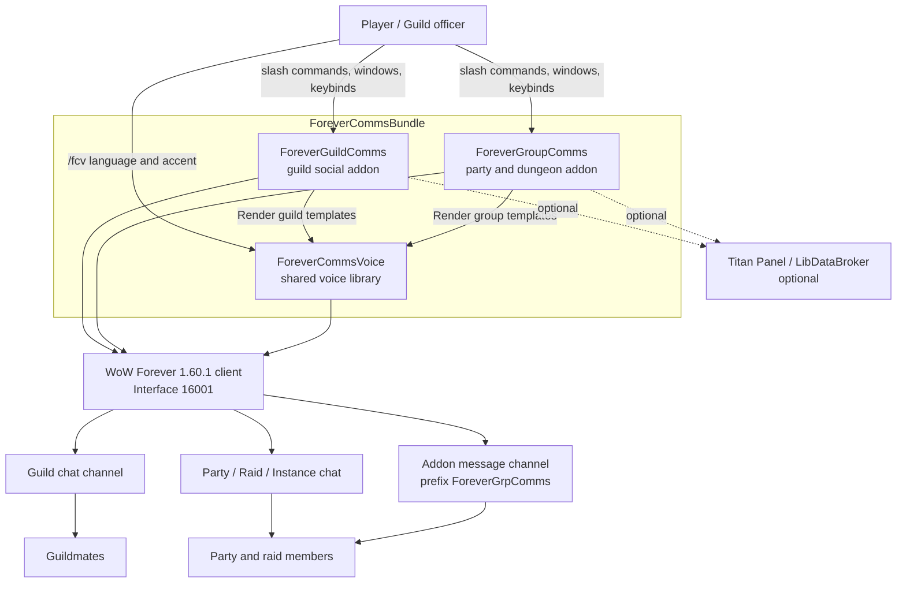

# Business Overview

**Target of analysis**: `ForeverCommsBundle` monorepo — ForeverCommsVoice 0.1.1-beta,
ForeverGroupComms 0.2.1-beta, ForeverGuildComms 0.5.1-beta.
**Analysis date**: 2026-10-19T11:30:00Z (sixth reverse-engineering pass, second multi-package pass)
**Change in this span**: a remediation release. No new business transaction was added; the
packaging and install path was rebuilt, two functional defects were fixed, and the shared
voice profile gained a single writer. See `code-quality-assessment.md`.

## Business Context Diagram

**Text alternative**: The player drives two behaviour addons, GuildComms and GroupComms.
Both delegate message wording to a third addon, ForeverCommsVoice, which owns the
per-character language and accent profile. All three run inside the WoW Forever client.
GuildComms writes to guild chat; GroupComms writes to party/raid/instance chat and
additionally exchanges quest IDs with peers over the addon message channel. Titan Panel
and LibDataBroker are detected at runtime and are optional for both behaviour addons.

## Business Description

- **Business Description**: A bundle of three World of Warcraft Forever addons that help a
  player stay socially present and coordinated without typing the same things repeatedly.
  **ForeverGuildComms** handles the guild-wide social layer: greeting guildmates on login,
  welcoming new members, congratulating other members' level-ups, surfacing private alerts
  for crafting and group requests seen in guild chat, reminding the player about the guild
  tabard in capital cities, and composing one explicit "ask for help" request.
  **ForeverGroupComms** handles the small-group layer: greeting a new party, confirming
  roles, sending coordination calls, initiating native ready checks, marking targets, and
  comparing quest logs with other users of the addon so dungeon quests can be shared.
  **ForeverCommsVoice** is not a user-facing feature in its own right; it is the shared
  wording engine that gives both addons eight curated languages, 29 roleplay accents and
  non-repeating message variation from one per-character profile.

  The restructure in this pass is a **library extraction**, not a feature change for
  GuildComms. Four GuildComms modules that owned language, accent, race and variant data
  were lifted into the new shared addon, and GuildComms now reaches them through a
  25-line adapter. The payoff is that the new GroupComms addon inherits all eight
  languages and all 29 accents without duplicating them.

- **Business Transactions**:

  **ForeverCommsVoice (shared)**
  | # | Transaction | Description |
  | --- | --- | --- |
  | V1 | Resolve shared voice profile | Read/normalize `ForeverCommsVoiceCharDB.voice`; clamp language, accent, race filter and strength to valid values |
  | V2 | Migrate legacy guild voice settings | One-time adoption of an existing `ForeverGuildCommsCharDB.voice` into the shared table, latched by `migratedFromGuild` so later logins never overwrite shared edits |
  | V3 | Render a scoped message | Pick the catalog for scope `guild` or `group`, honour a consuming addon's custom template verbatim, apply language, apply accent, optionally vary, then interpolate and byte-clamp |
  | V4 | Select a non-repeating variant | Shuffle-bag selection per scope/kind/language/accent signature, exhausting every wording before reshuffling and avoiding a cross-bag immediate repeat |
  | V5 | Offer compatible accents | Filter the 29 accents by the selected language and, optionally, by the character's race |
  | V6 | Administer shared voice settings | `/fcv` and a Settings canvas panel; writes propagate to GuildComms' panel and help-request preview. **As of 0.1.1 this is the sole writer of the shared profile** — GuildComms' `A:SetVoiceOption` delegates here rather than validating and mutating the table itself |

  **ForeverGuildComms (guild social)**
  | # | Transaction | Description |
  | --- | --- | --- |
  | G1 | Capture guild roster baseline | First read after login, reload or guild change records state and sends nothing |
  | G2 | Greet a guildmate on login | Offline-to-online transition only, cooldown `loginCooldown`, default 300s |
  | G3 | Welcome a new guild member | Parsed from the localized `ERR_GUILD_JOIN_S` system line, 300s cooldown |
  | G4 | Congratulate another member's level-up | Online-to-online, strictly higher numeric level, 1800s cooldown; the player's own level-up is always excluded |
  | G5 | Verify a staged guild message | In `verify` mode each greeting waits in a private window for an explicit Send or Dismiss |
  | G6 | Drain the automatic send queue | Spacing of at least `max(3, messageSpacing)` seconds between automatic sends, re-checking guild identity before each one |
  | G7 | Alert on a craft request | Guild chat line containing both a request phrase and an exact cached recipe or output name; private only |
  | G8 | Alert on a group request | Guild chat LFG/LFM/LF patterns, suppressed when the line already matched a craft request; private only |
  | G9 | Scan learned recipes | Debounced read of the open profession window into a per-character cache |
  | G10 | Remind about the guild tabard | One prompt per city stay on entering a capital without item 5976; optional prompt on leaving while wearing it. Opens the character panel, never equips |
  | G11 | Compose and send a help request | Explicit button press, fingerprinted draft so Send posts exactly the previewed wording, one request per 20 seconds |
  | G12 | Administer guild settings | Settings canvas panel and a nested Titan menu writing through one `A:SetOption` |
  | G13 | Publish the guild indicator | Optional LibDataBroker object with online count, alert count and review count |
  | G14 | Run a keybound quick action | Three opt-in bindings; none of them sends guild chat |

  **ForeverGroupComms (party and dungeon)**
  | # | Transaction | Description |
  | --- | --- | --- |
  | P1 | Scan the group roster | Enumerate party or raid units, read assigned roles and levels, bump a `groupSerial` whenever the member set changes |
  | P2 | Greet a new group | Staged for review by default; `autoGreeting` makes it immediate |
  | P3 | Welcome a member who joined mid-run | Staged or automatic, keyed per member and group serial |
  | P4 | Congratulate a member's level-up | Requires a stable GUID and a strictly higher level, 180s cooldown, staged by default |
  | P5 | Review roles privately | Flags unassigned roles, and in a non-raid party a tank or healer count other than one |
  | P6 | Broadcast a role check | Explicit send of a role summary, collapsing to counts above 160 characters |
  | P7 | Send a coordination call | Pull, mana, regroup, wait-for-healer, CC moon, focus skull, interrupts, quest reminder |
  | P8 | Initiate a native ready check | Leader or raid assistant only, out of combat, via `C_PartyInfo.DoReadyCheck` |
  | P9 | Tally ready-check responses privately | Counts ready, not ready and unconfirmed; never announced to chat |
  | P10 | Mark a target | Skull or moon on a hostile selected unit, leader or assistant only |
  | P11 | Advertise active quest IDs | Chunked `Q` packets over the addon channel, suppressed when the quest signature has not changed within 240s |
  | P12 | Answer a peer's quest advertisement | Whispered `R` packet listing which of the IDs **the peer disclosed** this client has completed |
  | P13 | Compare quest logs | Classify each of the player's quests per member as missing, has, completed or unknown |
  | P14 | Share a quest | Manual button that asks WoW's own push API; the game validates eligibility |
  | P15 | Request a quest the player lacks | Reverse comparison, then a chat request naming the quest |
  | P16 | Administer group settings | Settings canvas panel with eight toggles plus a shortcut into the Voice panel |
  | P17 | Publish the group indicator | Optional LibDataBroker object with member count and pending suggestion count |

- **Business Dictionary**:

  | Term | Meaning |
  | --- | --- |
  | **Scope** | `guild` or `group` — selects which phrase catalog `V:Render` uses |
  | **Catalog** | A language-keyed table of message templates registered with `V:RegisterCatalog` |
  | **Kind** | A message type within a catalog: guild has `login`, `join`, `level`, `help`; group has 13 including `greet`, `roles`, `pull`, `skull`, `request` |
  | **Voice profile** | The per-character language, accent, race filter and accent strength, stored once in `ForeverCommsVoiceCharDB.voice` |
  | **Accent** | A curated roleplay or regional phrasebook with its own complete templates and an optional `flair` prefix. Writing style, not audio, and not Blizzard's in-game racial languages |
  | **Accent strength** | Subtle uses the phrasebook only; Moderate prepends the flair; Expressive adds a further flourish |
  | **Race filter** | Restricts the offered accents to those appropriate to `UnitRace("player")` |
  | **Shuffle bag** | Session-local permutation of the available wordings, exhausted before reshuffling, with a guard against an immediate cross-bag repeat |
  | **Baseline** | The first guild roster read of a session; updates state and deliberately sends nothing |
  | **Outgoing mode** | GuildComms-wide choice of `automatic` or `verify` for roster-triggered messages |
  | **Staged / suggestion** | A message held for an explicit click: GuildComms calls it an approval, GroupComms calls it a suggestion |
  | **Group serial** | A counter bumped whenever the GroupComms member set changes; stale suggestions and in-flight packets are discarded by serial |
  | **Private alert / notification** | Local chat-frame and window output only. Never emitted to any channel |
  | **Quest epoch** | A monotonically increasing stamp on the player's advertised quest list; a completion reply is only accepted for the current epoch |
  | **Q / R packet** | `Q` advertises the sender's active quest IDs to the group; `R` whispers back which of those IDs the responder has completed |
  | **Fingerprinted draft** | The cached help-request wording, keyed by every input that affects it, so Send posts exactly what the preview showed |

## Component Level Business Descriptions

### ForeverCommsVoice (shared library addon)
- **Purpose**: Own every piece of wording data and the logic that turns a message kind
  into final text, so two consuming addons share one per-character voice profile instead
  of duplicating eight languages and 29 accents.
- **Responsibilities**: Normalize and persist the shared voice profile; perform the
  one-time migration out of GuildComms' per-character table; hold the guild and group
  phrase catalogs, the accent phrasebooks, the race-to-accent map, the locale variants and
  the accent variants; resolve which accent applies; run the shuffle bags; render and
  byte-clamp the final string; present its own `/fcv` Settings panel.
- **Explicit non-responsibility**: it never sends chat, never registers a chat or combat
  event, and never decides *when* a message should go out. Consuming addons own delivery.

### ForeverGuildComms (guild social addon)
- **Purpose**: Keep a guild feeling populated and responsive with low effort, while
  keeping every automatic post inside strict anti-spam rules.
- **Responsibilities**: Guild roster baseline and diffing; the three automatic guild
  messages; the automatic queue and the verify-before-send backlog; private parsing of
  guild chat for craft and group requests; the per-character recipe cache; tabard
  reminders; the help composer; settings across a Settings panel, a Titan menu and three
  keybindings; the optional guild indicator.

### ForeverGroupComms (party and dungeon addon)
- **Purpose**: Reduce the repetitive typing of a dungeon run and make it obvious which
  party members are missing which quests, without taking any action on the player's behalf.
- **Responsibilities**: Group roster and role reading; staged or automatic group greetings
  and congratulations; the coordination message set; native ready-check initiation and a
  private response tally; target marking; the quest ID exchange protocol and both
  directions of quest comparison; manual quest sharing; its own settings panel and
  indicator.

## Product constraints that survive the restructure

These are deliberate and are still enforced in code:

- No automation of player actions. No gear equipping, no auto-accept, no auto-whisper, no
  auto-queue. The tabard feature opens the character panel; quest sharing asks WoW's own
  push API after a click; ready checks and target marks require leader or assistant rank
  and an explicit trigger.
- No congratulations for the player's own level-up. `A:IsSelf` in GuildComms checks GUID
  first, then normalized and realm-qualified names; GroupComms excludes `playerKey`.
- GuildComms scans **only** `CHAT_MSG_GUILD` for alerts.
- No hard library dependencies. LibDataBroker is reached through
  `LibStub("LibDataBroker-1.1", true)` in both behaviour addons.
- Alerts and notifications are private.

**One constraint changed scope, and the steering now says so.** The documented non-goal
"no addon-to-addon comms" belongs to GuildComms, and GuildComms still has none. GroupComms
introduces an opt-in quest-sync protocol as a headline feature, gated behind the
`questSync` setting, restricted to active quest IDs with no titles or progress, and
answering completion queries only for IDs a peer already disclosed. `.kiro/steering/product.md`
was rewritten in commit `76ca527` to scope the non-goal to GuildComms and record the
protocol's disclosure limits as product constraints in their own right, so the previously
reported contradiction is closed.

**One constraint was clarified rather than changed.** "No hard library dependencies" means
no hard *third-party* dependency. LibDataBroker remains probed at runtime with
`LibStub(..., true)` and both applications work fully without it; nothing is vendored.
`ForeverCommsVoice` is a hard dependency and is first-party. As of this span the install
path enforces the relationship instead of merely declaring it: every individual source
archive bundles the library, and the installer prepends it to any consumer-only selection.
