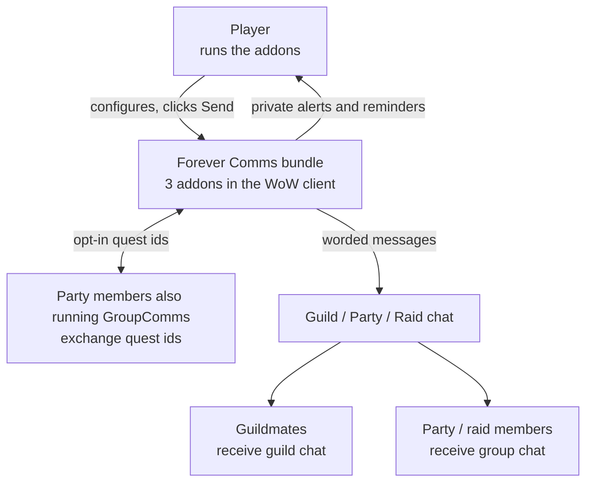

# Business Overview

**Target of analysis**: `ForeverCommsBundle` monorepo — ForeverCommsVoice 0.2.2-beta,
ForeverGroupComms 0.3.4-beta, ForeverGuildComms 0.6.3-beta.
**Analysis date**: 2026-10-25T03:10:00Z (ninth reverse-engineering pass, fifth
multi-package pass)
**Target commit**: `b712070`

## Business Context Diagram

## Business Description

**Business Description**: the bundle reduces the social and coordination effort of
playing on a small WoW Forever server. It notices things worth saying — a guildmate
coming online, someone levelling, a party forming, a dungeon quest nobody has — and
offers to say them in the player's chosen language and roleplay voice. The player stays
in control of what actually reaches a shared channel.

The product is deliberately narrow about that control. Three constraints shape every
feature:

1. **Nothing is said on the player's behalf without either an explicit setting or an
   explicit click.** The default for anything that posts unattended is the conservative
   one.
2. **No player action is ever automated.** The addons never equip gear, accept an invite,
   whisper, auto-reply, queue for content or accept a quest. The tabard feature opens the
   character panel and stops there.
3. **The player is never congratulated on their own achievement**, which is why
   self-exclusion is checked by GUID first and then by three name forms.

**Business Transactions**

Guild layer (ForeverGuildComms):

| # | Transaction | Trigger | Output |
| --- | --- | --- | --- |
| 1 | Greet a returning guildmate | Roster diff, offline → online | Guild chat, spaced or staged |
| 2 | Welcome a new member | Localized guild-join system message | Guild chat, spaced or staged |
| 3 | Congratulate another member's level-up | Roster diff, online → online, level increased | Guild chat, spaced or staged |
| 4 | Alert on a craft request | Guild chat matching a request phrase **and** a cached known recipe | Private alert only |
| 5 | Alert on an LFG/LFM request | Guild chat matching a group request pattern | Private alert only |
| 6 | Remind about the guild tabard | Entering or leaving a capital city | Popup; opens the character panel |
| 7 | Ask the guild for help | Player fills the composer and clicks Send | One guild message, rate-limited to one per 20 seconds |
| 8 | Review a staged message | Player opens the queue and clicks | The exact previewed text, floored at 2 seconds between approvals |
| 9 | Cache learned recipes | Opening a profession window | Per-character cache, no chat |
| 10 | Report status | `/fgc status` | Console only |

Group layer (ForeverGroupComms):

| # | Transaction | Trigger | Output |
| --- | --- | --- | --- |
| 11 | Greet a new party | Joining a group | Group chat, staged by default |
| 12 | Welcome a joining member | Roster identity change | Group chat, staged by default |
| 13 | Congratulate a grouped member's level-up | Level increase while grouped | Group chat, staged by default |
| 14 | Confirm roles | Player clicks, or an identity change triggers a private alert | Group chat on click; private otherwise |
| 15 | Coordination calls — pull, mana, regroup, wait for healer, interrupts, CC moon, focus skull | Player clicks | Group chat, unaccented and plain |
| 16 | Start a ready check | Player clicks | Native client ready check, leader or raid assistant only |
| 17 | Tally ready-check responses | `READY_CHECK_FINISHED` | Private notification only; never announced |
| 18 | Mark a target | Player clicks | Raid marker, leader or raid assistant only |
| 19 | Advertise active quest ids | Quest log change, debounced | Addon message to the group, opt-in |
| 20 | Answer a completion query | Receiving a peer advertisement | Addon whisper, only for ids the peer disclosed |
| 21 | Compare quest logs | Player opens the window | Local UI: shared / missing / completed / unknown |
| 22 | Share a quest | Player clicks | Native push API, to the whole group |
| 23 | Request a quest a peer has | Player clicks | One group chat message |
| 24 | Remind about dungeon quests | Group identity change | Private notification only |

Shared layer (ForeverCommsVoice):

| # | Transaction | Trigger | Output |
| --- | --- | --- | --- |
| 25 | Word a message | A consumer calls `V:Render` | A worded, byte-clamped string. Never sent by the library |
| 26 | Vary wording without repeating | `V:Pick` shuffle bags | A template, exhausting a bank before repeating |
| 27 | Hold a message for approval | A consumer calls `V:Enqueue` | A queued record with a monotonic id |
| 28 | Approve a held message | Player clicks | The consumer's own callback, once |
| 29 | Expire a held message | Per-record timeout | **Silently skipped. Never sent** |
| 30 | Adopt legacy voice settings | First load after upgrade | One-time copy, latched |
| 31 | Edit the shared profile | `/fcv` or either consumer's panel | A validated write through the single writer |

**Business Dictionary**

| Term | Meaning |
| --- | --- |
| **Scope** | Which catalog a message is worded from: `guild` or `group` |
| **Kind** | Which message: `login`, `join`, `level`, `help`, `greet`, `welcome`, `pull`, `skull`, … |
| **Voice profile** | The per-character language, accent, race filter and strength. One table, shared by both consumers, one writer |
| **Accent** | A curated English-language roleplay phrasebook. Not a phonetic claim about real people and not Blizzard's in-game racial languages |
| **Strength** | How heavily an accent is applied: Subtle (wording only), Moderate (adds a catchphrase), Expressive (catchphrase + emphasis) |
| **Flair** | The catchphrase prefix an accent contributes, e.g. `By the forge! ` |
| **Expressive punctuation** | At Expressive only, a final `.` becomes `!` and a final `!` becomes `!!`. Applies to guild messages except `help`, and to group `greet`/`welcome`/`level` only |
| **Staged / staged for review** | Worded and held in the shared queue, awaiting a click. Nothing has been sent |
| **Automatic vs Verify** | GuildComms' outgoing mode. Automatic posts with spacing; Verify requires a click for every message |
| **Baseline** | The first roster read after login or a guild change. Updates state and sends nothing |
| **Suspicious read** | A roster read that is empty, or collapses below 70% of the known count in a guild of more than 10. Discarded without touching state |
| **`groupSerial`** | A counter bumped whenever party membership identity changes. Stamps staged messages and queued packets so none can reach a different group |
| **`questEpoch`** | A counter identifying the local quest advertisement a completion reply must match |
| **Stale** | A staged message whose captured identity no longer matches. Dropped, never retargeted |
| **Private** | Shown only to the player: console, the alert list, or a notification. Never chat |

## Component Level Business Descriptions

### ForeverCommsVoice

- **Purpose**: own how an addon-generated message is worded, and own the single backlog of
  messages waiting on the player's click.
- **Responsibilities**: the per-character voice profile and its only writer; 8 languages;
  29 accent phrasebooks; the race-to-accent map and filtering; the guild and group phrase
  catalogs; non-repeating variant selection; the accent-strength rules including which
  message kinds they reach; the 250-byte UTF-8-safe chat clamp; the shared review queue
  with its bound, per-record expiry and movable overlay.
- **Explicitly not responsible for**: sending anything, reading chat, or taking any
  automatic action. It has no concept of a guild or a party beyond a scope label.

### ForeverGuildComms

- **Purpose**: handle the guild-facing social moments so the player does not have to watch
  the roster.
- **Responsibilities**: noticing login, join and level transitions without acting on a
  partial roster read; excluding the player from their own congratulations; spacing
  automatic guild messages; holding messages for review when asked; detecting craft and
  LFG requests in guild chat and keeping those alerts private; caching learned recipes per
  character; reminding about the tabard without touching gear; composing one explicit help
  request.

### ForeverGroupComms

- **Purpose**: handle party and dungeon coordination, and answer "does everyone have the
  quest?" without anyone typing it.
- **Responsibilities**: tracking group identity so nothing leaks between parties; staging
  social messages for review by default; keeping coordination calls plain and unaccented
  so they are followable under pressure; gating ready checks and target marking on real
  group rank; exchanging only active quest ids with consenting peers, and answering
  completion only for ids already disclosed; keeping the ready-check tally and quest
  reminders private.

## Where the product stands

The nine-pass history has moved this from one flat addon to a three-package bundle whose
offline behaviour is now well covered: 28 harnesses, 4,257 lines of test against 3,967
lines of shipped Lua, a linter reporting zero errors, and a mutation check confirming all
31 of its deliberately injected faults are caught.

The business risk is unchanged and is not a code risk: **no part of this bundle has ever
run in the client it is written for.** Every behaviour above is implemented against the
documented Forever 1.60.1 API and verified against mocks. Until the in-game checklist is
walked, the honest status is that the product is well-built and unproven.
