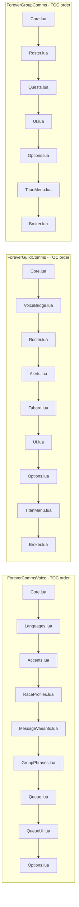

# Code Structure

**Target**: ForeverCommsVoice 0.2.2-beta, ForeverGroupComms 0.3.4-beta, ForeverGuildComms 0.6.3-beta
**Analysis date**: 2026-10-25T03:10:00Z
**Target commit**: `b712070`

## Build System

- **Type**: none for the Lua itself. Lua ships as source; the client loads it from TOC
  manifests. There is no compile, transpile or bundle step.
- **Release**: **BigWigsMods/packager `@v2`** driven by the root `.pkgmeta`, run from
  `.github/workflows/package.yml`. `tools/package.py` is a local mirror reading the
  **same** `.pkgmeta`, so the two cannot disagree about what ships.
- **Key configuration files**:

| File | Role |
| --- | --- |
| `<Addon>/<Addon>.toc` ×3 | Module load order, version, SavedVariables, dependencies |
| `.pkgmeta` (root) | `package-as: ForeverCommsBundle` plus `move-folders` lifting the three addons to top level, plus the ignore list. **The single source of truth for what ships** |
| `<Addon>/.pkgmeta` ×3 | For the standalone-repository case only |
| `.luacheckrc` (root) | Linter configuration covering all three packages |
| `.github/workflows/package.yml` | Checkout → install Lua 5.1 → **run all 28 harnesses** → BigWigs build → structure check → artifact → Release on a tag |
| `<Addon>/.github/workflows/package.yml` ×3 | Standalone case only; each carries a header comment saying so |

## Module hierarchy

Load order is dependency order. `Core.lua` is always first and declares every piece of
state with a safe initial value, so a later file can never index nil.

## Existing Files Inventory

### ForeverCommsVoice — 1,221 shipped lines

| File | Lines | Methods | Purpose |
| --- | --- | --- | --- |
| `Core.lua` | 251 | 9 | Namespace published as `_G.ForeverCommsVoice`; voice defaults; the profile getter, validator and sole writer; the legacy migration latch; the catalog registry; `V:Format` with the byte clamp; shuffle-bag `V:Pick`; `V:Render` as a dispatcher over per-scope resolvers plus `pickTemplate`, `flairApplies` and `applyFlair` |
| `Languages.lua` | 81 | 0 | 8 language definitions and the guild locale template bank |
| `Accents.lua` | 51 | 0 | 29 accent registrations via a local `register` helper: id, label, language, four guild templates, flair prefix |
| `RaceProfiles.lua` | 76 | 5 | Race-to-accent map, availability filtering, role and activity localization |
| `MessageVariants.lua` | 200 | 0 | Accent and locale variant banks for guild wording |
| `GroupPhrases.lua` | 144 | 0 | Group/dungeon catalog for 8 languages plus curated per-accent group wordings; registers both catalogs |
| `Queue.lua` | 148 | 12 | The shared review queue: persisted settings with clamping, enqueue with a 100-entry bound, approve/skip/skip-all, per-record expiry on a `C_Timer` ticker |
| `QueueUI.lua` | 136 | 4 | Movable scrollable overlay, countdown refresh |
| `Options.lua` | 134 | 3 | Settings canvas panel, `/fcv`, and this addon's `ADDON_LOADED` frame |
| `tests/*.lua` | 1,053 | — | 8 harnesses, none in the TOC |
| `README.md` | 97 | — | User documentation, current at 0.2.2-beta, with release notes |

### ForeverGuildComms — 1,580 shipped lines

| File | Lines | Methods | Purpose |
| --- | --- | --- | --- |
| `Core.lua` | 570 | 31 | **The load-time library guard, as the first statement**; defaults and timing limits; `A:FillDefaults`; `A:CanFillRole`; `A:Key`/`A:IsSelf`; `A:ChatLimit`; dedup with periodic pruning; `A:SendGuild` through `pcall`; `A:QueueGuild` → `A:DrainQueue` spacing; `A:StageApproval`; the approval floor; settings writers shared by Settings and Titan; the single 14-event dispatcher; `/fgc` |
| `VoiceBridge.lua` | 28 | 6 | Forwarders to the library. Returns quietly when the library is absent rather than raising a second error, because `Core.lua` has already refused and a Lua error in one TOC file does not stop the client loading the rest |
| `Roster.lua` | 123 | 7 | Roster request throttle, read, baseline capture, diff with self-exclusion, the suspicious-read guard, localized guild-join parsing, 60-second ticker |
| `Alerts.lua` | 99 | 5 | `cleanChat` escape stripping, craft and group request detection, recipe cache scan, the 30-entry private alert list |
| `Tabard.lua` | 70 | 2 | Capital-city detection, tabard checks, `StaticPopupDialogs` |
| `UI.lua` | 229 | 11 | Alerts window with 7 fixed paged rows; help composer with a fingerprinted preview draft so the Send button sends exactly what is shown |
| `Options.lua` | 294 | 1 | Settings canvas panel; `OnDefault` preserves `outgoingMode` and leaves the shared profile alone |
| `TitanMenu.lua` | 129 | 2 | Nested context menu |
| `Broker.lua` | 38 | 2 | Optional LibDataBroker object |
| `Bindings.xml` | 14 | — | Three keybindings. **Not in the TOC** — the client auto-loads it |
| `tests/*.lua` | 1,490 | — | 13 harnesses, none in the TOC |
| `README.md` | 212 | — | User documentation, current at 0.6.3-beta, with release notes |
| `PACKAGING.md` | 91 | — | Per-package release guide, current at 0.6.3-beta |

### ForeverGroupComms — 1,166 shipped lines

| File | Lines | Methods | Purpose |
| --- | --- | --- | --- |
| `Core.lua` | 300 | 21 | **The load-time library guard, as the first statement**; defaults; local English variant bank; `A:Trim`; `A:Render` with the `useSharedVoice` branch; `A:GroupChannel`; dedup; `A:Notify` with cap; **`A:SendPrepared` as the single send funnel** carrying the 2-second floor and the serial check; `A:Stage`/`A:Approve`; `A:CanManageGroup`; ready check; target marking; the single 10-event dispatcher; `/fgp` |
| `Roster.lua` | 162 | 6 | Group scan, `groupSerial` bump on identity change plus approval wipe and queue purge, greeting and level staging, role counts, issues and summary, ready-check tally |
| `Quests.lua` | 303 | 12 | The quest-sync protocol: `parseIDs`, `packetize` with the 12-chunk refusal, prefix registration, `A:QueuePacket` with the 60-entry bound, `A:FlushPackets` with 1.15s pacing and token cancellation, debounced scheduling, broadcast with the 240-second unchanged-log skip, completion replies, inbound validation and reassembly, comparison rows, sharing and requesting |
| `UI.lua` | 164 | 6 | Group panel and the quest comparison window with 9 fixed paged rows |
| `Options.lua` | 87 | 2 | Settings canvas panel with `OnRefresh`, `OnDefault` and a documented absent `OnCommit`; `A:RefreshOptions` |
| `TitanMenu.lua` | 114 | 4 | Nested context menu, `A:StatusSnapshot` |
| `Broker.lua` | 36 | 2 | Optional LibDataBroker object |
| `Bindings.xml` | 11 | — | Three keybindings. **Not in the TOC** |
| `tests/*.lua` | 1,714 | — | 7 harnesses, none in the TOC |
| `README.md` | 83 | — | User documentation, current at 0.3.4-beta, with release notes |

### Repository root

| File | Purpose |
| --- | --- |
| `README.md` | Bundle overview, install, shared queue, Titan menus, testing, release notes |
| `PACKAGING.md` | Bundle release guide; the four version locations per package |
| `SUGGESTED-CHANGES.md` | **44-item remediation ledger.** Records the decision and reasoning for every item, including the one rejected |
| `.pkgmeta` | What ships |
| `.luacheckrc` | Linter config |
| `.gitattributes`, `.gitignore` | Line endings; ignores `.release/` |
| `tools/*.py` | `run_tests`, `package`, `check_bigwigs_bundle`, `verify_package`, `fault_inject` |
| `package.ps1` / `package.cmd` / `run-tests.cmd` | Windows launchers |
| `install/` | Combined installer |
| `.kiro/steering/*.md` | 9 steering files |

## Design Patterns

### Shared-namespace module pattern

- **Location**: every shipped `.lua` file.
- **Purpose**: one table per addon, no globals beyond the published namespace.
- **Implementation**: `local _, A = ...` (or `local ADDON, A = ...` in `Core.lua`).
  `Core.lua` publishes `_G.<AddonName> = A`. Behaviour attaches as `function A:Method()`.
  File-local helpers stay `local function` and are unreachable from outside.

### Single event dispatcher per addon

- **Location**: bottom of `Core.lua` for both consumers; bottom of `Options.lua` for Voice.
- **Purpose**: one place where events arrive, one initialization gate, no scattered frames.
- **Implementation**: one `CreateFrame("Frame")`, `RegisterEvent` calls, a single
  `OnEvent` handler with `if not A.initialized then return end` and guarded routing.

### Validating single writer

- **Location**: `V:SetOption`, `V:SetQueueOption`, `A:SetOption`, `A:SetVoiceOption`.
- **Purpose**: a setting cannot be set to an invalid value from any entry point.
- **Implementation**: each validates, clamps or rejects, writes, then refreshes dependent
  UI. Settings panels and Titan menus call them rather than writing `db` directly;
  `A:SetVoiceOption` delegates to `V:SetOption` so the library stays the sole profile writer.

### Serial and epoch invalidation

- **Location**: `groupSerial` in GroupComms; `questEpoch` in `Quests.lua`; the guild name
  captured in `A:StageApproval`.
- **Purpose**: work prepared for one group or guild must never execute against another.
- **Implementation**: the identity is captured into the staged record or closure, then
  compared again at send time. A mismatch returns `false, "stale"`, which the shared queue
  consumes to drop the item rather than retry it.

### Debounce with a latch or stamp

- **Location**: `baselineTimer`, `ScheduleRecipeScan`, `ScheduleTabardCheck`,
  `ScheduleQuestSync`, `rosterRequest`, `outboxBusy`/`outboxToken`.
- **Purpose**: collapse event storms into one run, and cancel superseded work.
- **Implementation**: `C_Timer.After` plus either a boolean latch or a monotonic stamp
  re-checked inside the callback. **Zero `OnUpdate` handlers** remain in the bundle.

### Bounded transient store

- **Location**: review queue (100), approval list (30), alerts (30), notifications
  (`maxNotifications`, clamped 5–40), addon outbox (60), reassembly parts (60-second TTL).
- **Purpose**: a long session or a hostile peer cannot grow memory without limit.
- **Implementation**: either refuse at the bound or drop the oldest. A dropped queue entry
  never has its callback invoked, which `queue.lua` asserts directly.

### Fail-closed feature detection

- **Location**: every non-trivial client API; see `dependencies.md` for the table. Also
  the library dependency itself, at the first statement of both consumers' `Core.lua`.
- **Purpose**: a beta client may not expose what the code expects, and a dependency that
  the client considered satisfied may still have failed to initialise.
- **Implementation**: `if C_X and C_X.Y then`. Where the answer gates a privileged action,
  absence means deny — `A:CanManageGroup` returns false rather than assuming permission.
  Where it gates the whole addon, absence means refuse to load: erroring at the first
  statement leaves the namespace unpublished and the dispatcher uncreated, so the addon is
  inert rather than degraded. Degrading was measured to be *incorrect* here, not merely
  reduced — the fallback approval path re-renders rather than replaying reviewed text.

## Critical Dependencies

### ForeverCommsVoice (internal)

- **Version**: 0.2.2-beta, in-repository.
- **Usage**: both consumers declare it in `## Dependencies` and will not load without it.
- **Purpose**: all wording plus the shared review queue.

### WoW Forever client API

- **Version**: 1.60.1, Interface `16001`, identical in all three TOCs.
- **Usage**: the entire runtime.
- **Purpose**: frames, chat, roster, quests, timers, settings, bindings.

### Titan Panel / LibDataBroker-1.1

- **Version**: whatever the user has.
- **Usage**: `LibStub("LibDataBroker-1.1", true)` at runtime only.
- **Purpose**: an optional broker button. Nothing is vendored and nothing breaks without it.
