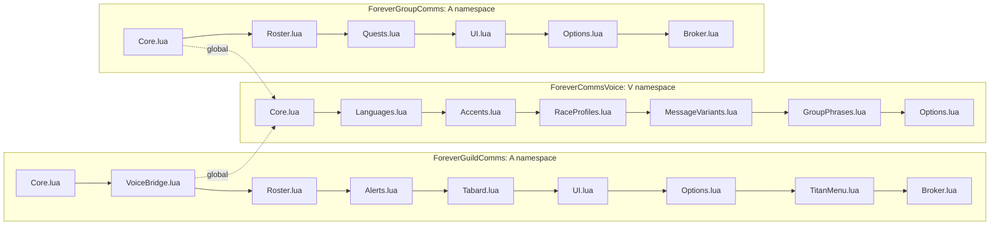

# Code Structure

**Analysis date**: 2026-10-19T11:30:00Z
**Target**: ForeverCommsVoice 0.1.1-beta, ForeverGroupComms 0.2.1-beta, ForeverGuildComms 0.5.1-beta

## Build System

- **Type for the addons**: none. There is no compile, transpile or bundle step. Lua 5.1
  source is loaded directly by the WoW client in TOC order.
- **Type for releases**: two equivalent hand-written offline builders, new this span. No
  external packager on the suite path, no network, no secrets, no third-party package.
- **Configuration**:
  | File | Role |
  | --- | --- |
  | `<Addon>/<Addon>.toc` | The only manifest the client reads: metadata plus an ordered file list. All three now declare `## IconTexture:` |
  | `tools/package.py` | Primary builder, 97 lines, Python standard library only. `--runtime` for reduced archives |
  | `tools/verify_package.py` | Archive and source-fact verifier, 52 lines |
  | `package.ps1` / `package.cmd` | Windows builder, 72 + 11 lines, `System.IO.Compression` |
  | `.github/workflows/package.yml` | **Active suite workflow** at the repository root |
  | `<Addon>/.pkgmeta` | BigWigsMods exclusions, used only in the standalone-repository case. Now also exclude `Media/ProjectIcon.png` |
  | `<Addon>/.github/workflows/package.yml` | Retained for the standalone case only; each carries a header comment saying so |
  | `.gitattributes` | Repository-wide `eol=lf` normalization |
  | `.gitignore` | Generic Lua ignore list at the root; a packager-specific one inside GuildComms |

## Repository layout

```text
ForeverCommsBundle-Development/
  .gitattributes              repo-wide LF policy
  .gitignore                  generic Lua ignores; *.zip covers dist/ output
  LICENSE
  README.md                   24 lines: package table, install order, change list
  PACKAGING.md                38 lines: suite release guide
  package.cmd  package.ps1    offline Windows builder
  .github/workflows/
    package.yml               ACTIVE suite workflow
  tools/
    package.py                offline cross-platform builder (CI runs this)
    verify_package.py         archive + source-fact verifier
  install/
    Install-ForeverComms.cmd  the one real installer
    Install-ForeverComms.ps1  -Addons selection, dependency prepending, rollback
  ForeverCommsVoice/          library addon, 7 modules + Media/
  ForeverGuildComms/          guild addon, 9 modules + Bindings.xml + Media/
  ForeverGroupComms/          group addon, 6 modules + Bindings.xml + Media/
  aidlc-docs/                 documentation only, never loaded
  .kiro/                      steering and AI-DLC rule details
```

All three packages now carry `Media/Icon.tga` (64 KB, three distinct images confirmed by
hash) and `Media/ProjectIcon.png` (192 / 213 / 481 KB).

## Key Modules



**Text alternative**: Each package loads its modules in a strict TOC order with `Core.lua`
first. Arrows indicate load order, not call direction. The two cross-package edges are
GuildComms' `VoiceBridge.lua` and GroupComms' `Core.lua`, both reaching the Voice
namespace through the global `_G.ForeverCommsVoice`.

### Existing Files Inventory

#### ForeverCommsVoice 0.1.1-beta — 7 shipped modules, 872 lines, 18 methods

| File | Lines | Methods | Purpose |
| --- | --- | --- | --- |
| `ForeverCommsVoice.toc` | 13 | — | Interface 16001, `SavedVariablesPerCharacter: ForeverCommsVoiceCharDB`, no dependencies |
| `Core.lua` | 178 | 8 | Publishes `_G.ForeverCommsVoice`. Defaults, profile normalize/read, legacy migration, option validation and writing, catalog registry, `Format` with UTF-8-safe 250-byte clamp, `Pick` shuffle bag, `Render` |
| `Languages.lua` | 80 | 0 | 8 language descriptors, `languageByID`, `localeTemplates` for 4 guild kinds, `localeRoleNames`, `localeActivityTypes` |
| `Accents.lua` | 49 | 0 | 29 accents registered through a file-local `register` helper; `accentOrder` fixes the presentation order |
| `RaceProfiles.lua` | 108 | 6 | `raceAccents` map, `GetPlayerRace`, `GetAvailableAccents`, `ResolveAccent`, legacy `VoiceText`, `LocalizeRoleText`, `LocalizeActivityType` |
| `MessageVariants.lua` | 225 | 1 | `localeVariants` for 8 languages, `accentVariants` for all 29 accents, `ChooseMessageTemplate` shuffle bag |
| `GroupPhrases.lua` | 144 | 0 | `groupTemplates` for 8 languages across 13 kinds, `groupAccentVariants` for 29 accents, then the two `RegisterCatalog` calls that wire both scopes |
| `Options.lua` | 76 | 3 | `/fcv` and `/commsvoice`, Settings canvas panel, `RefreshOptions` control list, the package's only `CreateFrame` event frame |
| `tests/integration.lua` | 64 | — | Cross-package harness; loads all three addons |
| `README.md` | 26 | — | Library documentation, API example, migration notes |
| `.pkgmeta` | 6 | — | Ignores `.github`, `install`, `tests`, `README.md` |
| `.github/workflows/package.yml` | 18 | — | `v*` tag, BigWigsMods/packager@v2 |
| `install/*` | 316 | — | `.cmd` launcher, TOC-parsing PowerShell installer, 2-line README |

#### ForeverGuildComms 0.5.1-beta — 9 shipped modules, 1,534 lines, 64 methods

| File | Lines | Methods | Purpose |
| --- | --- | --- | --- |
| `ForeverGuildComms.toc` | 19 | — | Interface 16001, `IconTexture`, both SavedVariables, `Dependencies: ForeverCommsVoice`, `OptionalDeps: Titan` |
| `Core.lua` | 508 | 27 | Namespace, binding labels, defaults, timing clamps, bounded dedup cache, send queue, verify backlog, option writers, voice passthroughs, quick actions, `Initialize`, `/fgc`, the single 14-event frame |
| `VoiceBridge.lua` | 26 | 7 | The only coupling to the shared library. Hard `error()` if absent; aliases eight data tables; forwards six methods; rewrites `VoiceText` as `V:Render("guild", ...)` |
| `Roster.lua` | 121 | 7 | Throttled roster requests, `ReadRoster`, `AcceptRoster` diffing, `CaptureBaseline`, `OnRosterEvent` with the incomplete-read guard, `OnSystemGuildJoin`, `SetupRoster` |
| `Alerts.lua` | 98 | 5 | `cleanChat`, craft and group request matchers, `AddAlert` capped at 30, debounced `ScanRecipes`, `MatchCraft`, `OnGuildChat` |
| `Tabard.lua` | 65 | 2 | City tables by name and map ID, item-5976 check, two `StaticPopupDialogs`, `CheckTabard` ordering state machine, `ScheduleTabardCheck` |
| `UI.lua` | 301 | 11 | Alerts window, approvals window, help composer, `RequestText` with the fingerprinted draft, `SendHelpRequest` with the 20-second limit |
| `Options.lua` | 285 | 1 | 1,460-pixel scrolling Settings canvas; toggles, timing edit boxes, outgoing-mode radios, voice cyclers, four template editors, scroll anchors, `OnRefresh`/`OnCommit`/`OnDefault` |
| `TitanMenu.lua` | 115 | 2 | `PopulateTitanMenu` nested tree, `OpenTitanMenu` with the MenuUtil probe |
| `Broker.lua` | 38 | 2 | Optional LDB object and its text updater |
| `Bindings.xml` | 12 | — | Three opt-in bindings. **Deliberately not in the TOC**; the client auto-loads it from the addon root |
| `Media/Icon.tga` | 64 KB | — | Runtime texture used by the TOC, Broker, Options and the installer |
| `Media/ProjectIcon.png` | 481 KB | — | 512x512 promotional art; excluded by `.pkgmeta` |
| `tests/*.lua` | 826 | — | 11 harnesses, none in the TOC |
| `README.md` | 133 | — | User documentation. Title still reads 0.4.3-beta |
| `PACKAGING.md` | 91 | — | Release guide. Still states 0.4.3-beta and lists four modules that no longer exist here |

#### ForeverGroupComms 0.2.1-beta — 6 shipped modules, 982 lines, 47 methods

| File | Lines | Methods | Purpose |
| --- | --- | --- | --- |
| `ForeverGroupComms.toc` | 14 | — | Interface 16001, `SavedVariables: ForeverGroupCommsDB`, `Dependencies: ForeverCommsVoice`, `OptionalDeps: Titan`. No per-character table and no `IconTexture` |
| `Core.lua` | 253 | 20 | Namespace, binding labels, 9 defaults, the built-in English `variants` fallback, `Render` with the Voice branch, `GroupChannel`, bounded `IsDuplicate`, `Notify`, `Send` with a 2-second floor, `Stage`/`Approve`, `Quick`, rank checks, `ReadyCheck`, `MarkTarget`, `Initialize`, `/fgp`, the single 10-event frame |
| `Roster.lua` | 158 | 6 | `partyUnits`, `ScanRoster` with identity-change detection and `groupSerial`, greeting/welcome/level decisions, `RoleCounts`/`RoleSummary`/`RoleIssues`/`ReviewRoles`, `OnReadyCheckEvent` |
| `Quests.lua` | 301 | 12 | Prefix `ForeverGrpComms`, dual quest-log API support, `packetize`/`parseIDs`, paced outbox, `ScheduleQuestSync`, `BroadcastQuests`, `ReplyCompletions`, `OnAddonMessage`, `QuestRows`, `OtherQuestRows`, `ShareQuest`, `RequestQuest` |
| `UI.lua` | 175 | 6 | Main panel with twelve quick actions, role summary, three suggestion rows; paged quest window with a view switch |
| `Options.lua` | 64 | 1 | Eight toggles driven from a declarative table, plus a button into the Voice panel |
| `Broker.lua` | 27 | 2 | Optional LDB object. Uses `INV_Misc_QuestionMark` — the package ships no icon of its own |
| `Bindings.xml` | 11 | — | Three opt-in bindings, not in the TOC |
| `tests/smoke.lua` | 105 | — | Single harness; loads Core, Roster, Quests only |
| `README.md` | 41 | — | User documentation; version consistent with the TOC |

### Totals

| Metric | Voice | Guild | Group | Bundle |
| --- | --- | --- | --- | --- |
| Shipped Lua modules | 7 | 9 | 6 | **22** |
| Shipped Lua lines | 872 | 1,534 | 982 | **3,388** |
| Public methods | 18 | 64 | 47 | **129** |
| Registered events | 1 | 14 | 10 | **25** |
| Event dispatchers | 1 | 1 | 1 | **3** |
| Offline harnesses | 1 | 11 | 1 | **13** |
| Harness lines | 79 | 845 | 105 | **1,029** |
| SavedVariables tables | 1 | 2 | 1 | **4** |
| `Media/Icon.tga` | 1 | 1 | 1 | **3** |

### Non-package tooling

| File | Lines | Language |
| --- | --- | --- |
| `tools/package.py` | 97 | Python |
| `tools/verify_package.py` | 52 | Python |
| `package.ps1` | 72 | PowerShell |
| `package.cmd` | 11 | Batch |
| `.github/workflows/package.yml` | 30 | YAML |
| `install/Install-ForeverComms.ps1` | 153 | PowerShell |
| `install/Install-ForeverComms.cmd` | 12 | Batch |
| `<Addon>/install/Install-<Addon>.ps1` x3 | 13 each | PowerShell |
| `PACKAGING.md` | 38 | Markdown |
| `README.md` | 24 | Markdown |

## Design Patterns

### Shared-namespace module pattern
- **Location**: all 22 modules.
- **Purpose**: one table per addon, no module system, no new globals beyond the three
  addon tables, the `SLASH_*` entries and named frames.
- **Implementation**: `local _, A = ...` (or `local ADDON, V = ...` in a Core file).
  State is declared up front with a safe initial value so later files never index nil.
  The convention is now applied identically across three packages; GroupComms uses `A`
  for its own namespace, so the same identifier means different tables in different
  packages — which is why the harnesses pass the addon name explicitly to `loadfile`.

### Single event dispatcher per addon
- **Location**: bottom of each `Core.lua`; Voice's lives at the bottom of `Options.lua`.
- **Purpose**: one place to see every event, one place to enforce the initialization gate.
- **Implementation**: `CreateFrame("Frame")`, a block of `RegisterEvent` calls, one
  `OnEvent` with `if not A.initialized then return end` and guarded dispatch to module
  methods. GuildComms initializes on `PLAYER_LOGIN`; GroupComms and Voice initialize on
  `ADDON_LOADED` for their own addon name.

### Adapter / bridge
- **Location**: `ForeverGuildComms/VoiceBridge.lua`.
- **Purpose**: let 1,500 lines of existing GuildComms code keep calling the same method
  names after the implementation moved into another addon.
- **Implementation**: alias Voice's data tables onto `A` so Options.lua and TitanMenu.lua
  need no edits, forward six methods verbatim, and translate the one method whose contract
  changed — `VoiceText` becomes a `Render` call that passes the custom template, the
  randomize flag and the preview flag as options.

### Graceful degradation vs hard dependency
- **Location**: `VoiceBridge.lua` line 4 compared with `ForeverGroupComms/Core.lua`
  `A:Render`.
- **Purpose**: the two consumers made opposite choices deliberately.
- **Implementation**: GuildComms calls `error("ForeverGuildComms requires
  ForeverCommsVoice")` — its entire message layer is delegated, so a silent fallback
  would be worse than a load failure. GroupComms keeps a complete English copy of its
  phrase table and falls back to it whenever the global is missing or the user turns
  `useSharedVoice` off, which is also the mechanism behind the documented opt-out.

### Scoped catalog registry
- **Location**: `V:RegisterCatalog`, called twice at the end of `GroupPhrases.lua`.
- **Purpose**: one render pipeline serving two very different message families.
- **Implementation**: `V.catalogs["guild"]` and `V.catalogs["group"]`, both
  language-keyed. `V:Render` branches on scope for accent handling: guild messages use
  single accent templates plus a variant bank, group messages use accent variant lists
  directly, and the flair prefix is suppressed for `help` and for group combat kinds.

### Shuffle bag with cross-bag memory
- **Location**: `V:Pick` in Core.lua and `V:ChooseMessageTemplate` in MessageVariants.lua.
- **Purpose**: vary wording without immediate repeats.
- **Implementation**: a Fisher-Yates permutation per signature, consumed one entry per
  call; on reshuffle, if the new first entry equals the last one served, swap positions 1
  and 2. Session-local by design. **These are two near-identical implementations of the
  same algorithm** — see `code-quality-assessment.md`.

### Review-before-send
- **Location**: GuildComms `StageApproval`/`ApproveMessage`; GroupComms `Stage`/`Approve`.
- **Purpose**: the user, not a timer, authorizes social chat.
- **Implementation**: GuildComms gates on `db.outgoingMode == "verify"` and re-checks the
  guild identity at click time, discarding the entry if the guild changed. GroupComms
  stages by default — `autoGreeting` and `autoLevel` both default to `false` — and stamps
  each suggestion with `groupSerial`, refusing to send one that belongs to a prior group.

### Serial / epoch invalidation of deferred work
- **Location**: GroupComms `groupSerial`, `rosterRequest`, `syncSeq`, `outboxToken`,
  `questEpoch`.
- **Purpose**: a timer that fires after the world changed must not act on stale data.
- **Implementation**: capture the counter in the closure, compare on fire, return if it
  moved. Five independent counters guard roster rescans, outbound packets, sync
  scheduling, suggestion sends and completion replies.

### Debounce with a boolean latch
- **Location**: `ScheduleRecipeScan`, `ScheduleTabardCheck`, `baselineTimer`, `DrainQueue`,
  `FlushPackets`.
- **Purpose**: collapse event storms into one run.
- **Implementation**: a boolean or token set before `C_Timer.After`, cleared inside the
  callback.

### Bounded caches
- **Location**: GuildComms `PruneEventsSeen`; GroupComms `IsDuplicate` inline sweep and
  the `questParts` sweep in `OnAddonMessage`.
- **Purpose**: a long session must not grow a dedup table without limit.
- **Implementation**: GuildComms retains keys for `timingLimits.loginCooldown.max`
  (3600s), sweeping at most once per minute on activity plus a 300-second idle ticker.
  GroupComms retains notification keys for 1200s and packet-reassembly state for 60s,
  both swept at most once per minute.

### Single-writer delegation across the package boundary
- **Location**: `A:SetVoiceOption` in GuildComms `Core.lua`, new shape this span.
- **Purpose**: `A.char.voice` and `ForeverCommsVoiceCharDB.voice` are the same table object
  at runtime, so two independently implemented validators could diverge and either addon
  could mutate the other's live settings.
- **Implementation**: the method shrank from 27 lines of validation and direct mutation to
  a 7-line delegation to `V:SetOption`, with a comment stating that the library owns
  validation, mutation and dependent UI refresh. The library's own back-probe into
  `_G.ForeverGuildComms` is what keeps the consumer's panel current, which makes that
  previously-optional probe load-bearing.
- **Corollary**: `panel.OnDefault` no longer resets the shared values at all, because
  Restore Defaults is scoped to the addon whose panel it is.

### Validation inside the build, not beside it
- **Location**: `manifest()` in `tools/package.py`, the per-addon loop in `package.ps1`,
  and `Get-RuntimeFiles` in `install/Install-ForeverComms.ps1`.
- **Purpose**: a malformed release should fail to build rather than ship.
- **Implementation**: all three derive their file list from the TOC and refuse an entry
  that is not `^[A-Za-z0-9_-]+\.(lua|xml)$`, a missing file, a duplicate entry, a wrong
  `IconTexture` path, a missing icon or project icon, a consumer without
  `## Dependencies: ForeverCommsVoice`, and any archive member containing `..` or a
  leading `/`. The Python builder additionally skips symlinks; the PowerShell builder
  rejects any source path outside the repository root.

### Dependency satisfied by construction
- **Location**: `tools/package.py` `main()`, `package.ps1`'s archive loop, and the
  `-Addons` handling in `install/Install-ForeverComms.ps1`.
- **Purpose**: make a dependency-less installation unreachable rather than merely warned
  about.
- **Implementation**: each consumer's release archive contains a complete
  `ForeverCommsVoice/` tree, and the installer prepends `ForeverCommsVoice` to any
  selection naming a consumer, then reorders to canonical dependency order. The three
  per-addon installers are 13-line shims, so there is one code path to get right.

### UTF-8-safe byte clamp, implemented three times
- **Location**: `V:Format` in Voice Core.lua, `A:ChatLimit` in GuildComms Core.lua,
  `A:Trim` in GroupComms Core.lua.
- **Purpose**: a translated string can exceed WoW's 250-byte chat cap, and a naive
  `sub(1,250)` can split a multibyte character.
- **Implementation**: walk backwards from byte 251 while the byte is a UTF-8
  continuation byte. All three copies are character-for-character equivalent.

### Declarative widget construction
- **Location**: `Label`/`Button`/`Check` in GuildComms UI.lua; `MakeLabel`/`MakeButton`
  in GuildComms Options.lua; `text`/`button`/`makeFrame` in GroupComms UI.lua;
  `label`/`cycle` in Voice Options.lua; the `options` table in GroupComms Options.lua.
- **Purpose**: keep panel code readable without a UI framework.
- **Implementation**: file-local constructors returning a configured widget, plus a
  `controls` list of refresh closures so one `RefreshOptions` call re-reads every control.

### Feature detection before every API call
- **Location**: pervasive.
- **Purpose**: the Forever client is a beta that may add or omit APIs.
- **Implementation**: `if C_GuildInfo and C_GuildInfo.GuildRoster then ... end`,
  `(C_PartyInfo and C_PartyInfo.DoReadyCheck) or DoReadyCheck`,
  `SetRaidTarget or SetRaidTargetIcon`, dual quest-log API paths, `pcall` around every
  protected call that can error.

## Critical Dependencies

### ForeverCommsVoice
- **Version**: 0.1.0-beta, in-repository.
- **Usage**: declared as `## Dependencies:` by both behaviour addons; reached at runtime
  through `_G.ForeverCommsVoice`.
- **Purpose**: single source of wording data and the shared per-character voice profile.
- **Risk**: there is no version negotiation. Neither consumer inspects `V.version` before
  calling `V:Render`, and the client's `## Dependencies:` check verifies presence, not
  version. A future breaking change to `Render`'s options table would surface as a
  runtime error rather than a load-time refusal.

### WoW Forever 1.60.1 client API — Interface 16001
- **Version**: 16001 in all three TOCs.
- **Usage**: every function call that is not pure Lua.
- **Purpose**: the runtime.
- **Risk**: beta. Mitigated by feature detection and `pcall`, not eliminated.

### LibDataBroker-1.1
- **Version**: whatever Titan Panel embeds, typically 9.3.5's copy.
- **Usage**: `LibStub("LibDataBroker-1.1", true)` in both `Broker.lua` files; both bail
  out silently when absent.
- **Purpose**: the optional panel indicator.
- **License**: not vendored, so not applicable.

### Blizzard MenuUtil
- **Usage**: `MenuUtil.CreateContextMenu` in GuildComms `OpenTitanMenu`, with a printed
  notice and a Settings-page fallback when missing.
- **Purpose**: the nested right-click menu.

### Lua 5.1 standard library
- **Usage**: `string`, `table`, `math`, `pairs`/`ipairs`, `pcall`, `tonumber`/`tostring`,
  and the WoW-provided `wipe` and `date`.
- **Purpose**: everything else. No LuaJIT extensions are used.
