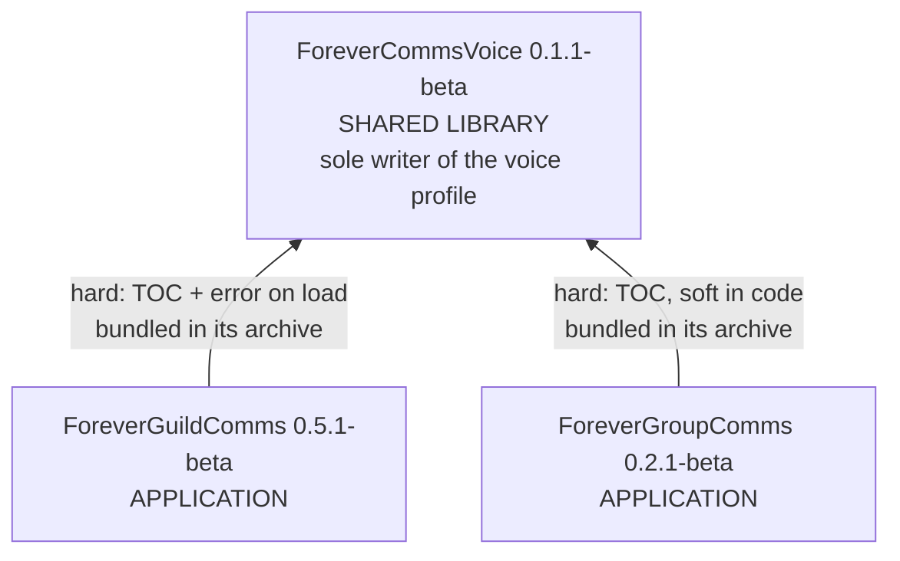

# Component Inventory

**Analysis date**: 2026-10-19T11:30:00Z
**Target**: ForeverCommsVoice 0.1.1-beta, ForeverGroupComms 0.2.1-beta, ForeverGuildComms 0.5.1-beta

## Application Packages

| Package | Version | Modules | Lines | Methods | Purpose |
| --- | --- | --- | --- | --- | --- |
| `ForeverGuildComms` | 0.5.1-beta | 9 | 1,534 | 64 | Guild social layer: login greetings, new-member welcomes, level congratulations, automatic-or-verify delivery, private craft and LFG alerts, recipe cache, tabard reminders, help composer, Titan menu, keybindings |
| `ForeverGroupComms` | 0.2.1-beta | 6 | 982 | 47 | Party and dungeon layer: group greetings and congratulations staged for review, coordination calls, native ready checks and a private response tally, target marking, bidirectional quest-log comparison over an opt-in addon protocol, manual quest sharing |

## Shared Packages

| Package | Version | Type | Modules | Lines | Methods | Purpose |
| --- | --- | --- | --- | --- | --- | --- |
| `ForeverCommsVoice` | 0.1.1-beta | Library / Models | 7 | 872 | 18 | The only shared package. Owns the per-character voice profile and is now its **sole writer**, plus 8 curated languages, 29 accent phrasebooks, the race-to-accent map, the guild and group phrase catalogs, the variant banks, the shuffle bags, and the `Render` pipeline. Declared as a hard `## Dependencies:` entry by both behaviour addons |

Content owned by the shared package:

| Asset | Count |
| --- | --- |
| Languages | 8 — en, es, fr, de, it, pt, pl, nl |
| Accents | 29 — 8 regional English, 13 WoW roleplay voices, 8 regional variants of translated languages |
| Guild message kinds | 4 — login, join, level, help |
| Group message kinds | 13 — greet, welcome, level, roles, quests, pull, mana, regroup, heal, cc, skull, interrupt, request |
| Registered catalog scopes | 2 — guild, group |
| Role and activity label sets | 8 languages each |

## Infrastructure Packages

None. No CDK, Terraform, CloudFormation or container definition. "Deployment" is a file
copy into the client's `AddOns` directory.

Build and install tooling, rebuilt this span, now lives partly at the repository root
rather than entirely inside the packages:

| Artifact | Lines | Location | Purpose |
| --- | --- | --- | --- |
| `package.yml` | 30 | `.github/workflows/` | **Active suite workflow.** Runs the Python builder and verifier on `workflow_dispatch` or a `v*` tag, uploads four ZIPs, attaches them to a Release on a tag |
| `package.py` | 97 | `tools/` | Offline cross-platform builder, standard library only. `--runtime` mode for reduced archives. The builder CI runs |
| `verify_package.py` | 52 | `tools/` | Archive and source-fact verification. Asserts TOC/README version agreement, archive membership, dependency bundling, and this span's two Lua fixes |
| `package.ps1` + `package.cmd` | 72 + 11 | repository root | Offline Windows builder, equivalent contract. No `--runtime` mode. The documented Windows entry point |
| `PACKAGING.md` | 38 | repository root | Suite packaging and release guide. Distinguishes the one-repository layout from three standalone repositories |
| `Install-ForeverComms.ps1` + `.cmd` | 153 + 12 | `install/` | The one real installer. `-Addons` selection, dependency prepending, TOC-derived file lists, staging, backup outside `AddOns`, rollback |
| `Install-<Addon>.ps1` x3 | 13 each | `<Addon>/install/` | Shims that delegate to the shared installer with their own name |
| `Install-<Addon>.cmd` x3 | 31 each | `<Addon>/install/` | Launchers. The only remaining per-package version strings besides the TOC, `Core.lua` and README |
| `INSTALL-README.txt` x3 | 14-16 | `<Addon>/install/` | Manual instructions. **The ForeverCommsVoice copy is template-generated and self-referential** — see `code-quality-assessment.md` new finding #1 |
| `package.yml` x3 | 19 each | `<Addon>/.github/workflows/` | BigWigsMods/packager, retained for the standalone-repository case. Each now carries a header comment stating it is active only then |
| `.pkgmeta` x3 | 7 each | `<Addon>/` | Packager exclusions, now also excluding `Media/ProjectIcon.png` |
| `PACKAGING.md` | 8 | `ForeverGuildComms/` | Reduced from 91 lines to a pointer at the root guide |

## Test Packages

No separate test packages. Each package carries its own `tests/` directory, none listed in
a TOC and none shipped in a `--runtime` archive.

| Location | Harnesses | Lines | Type | Notes |
| --- | --- | --- | --- | --- |
| `ForeverGuildComms/tests/` | 11 | 845 | Unit / integration | `syntax`, `smoke`, `verify`, `settings`, `timing`, `titanmenu`, `voice`, `keybindings`, `icon`, `tabard_dedup`, `variations`. Eight load the sibling `ForeverCommsVoice` folder; `settings.lua` now also loads `ForeverGroupComms/Core.lua`, and `icon.lua` now reads the shared installer at `../install/` |
| `ForeverGroupComms/tests/` | 1 | 105 | Integration | `smoke` — roster, roles, level suggestions, quick actions, the full Q/R round trip, sharing, and staleness. Loads Core, Roster and Quests; stubs UI, Options and Broker |
| `ForeverCommsVoice/tests/` | 1 | 79 | Cross-package integration | `integration` — the only harness that loads **all three** packages. Gained the Expressive punctuation regression block this span |

**No syntax harness exists for Voice or GroupComms**, so 13 of 22 modules have no compile
guard.

## Documentation and tooling (non-shipped)

| Location | Purpose |
| --- | --- |
| `aidlc-docs/` | AI-DLC state, audit log and these artifacts. Documentation only |
| `.kiro/steering/` | 9 files: 8 addon-specific, rewritten for the bundle in commit `76ca527`, plus the AI-DLC `core-workflow.md`. Three "Known deviation" blocks in them are now stale because this span closed the deviations |
| `.kiro/aws-aidlc-rule-details/` | AI-DLC rule detail files |
| `README.md` (root) | 24 lines. Package table, install order, change list, packaging pointer |
| `LICENSE` | Repository root; not duplicated into the packages |

## Total Count

- **Total Packages**: 3
- **Application**: 2 — ForeverGuildComms, ForeverGroupComms
- **Infrastructure**: 0
- **Shared**: 1 — ForeverCommsVoice
- **Test**: 0 as packages; 3 `tests/` directories holding 13 harnesses

### Aggregate

| Metric | Value | Change this span |
| --- | --- | --- |
| Shipped Lua modules | 22 | — |
| Shipped Lua lines | 3,388 | -7 |
| Public methods | 129 | — |
| Registered events | 25 across 3 dispatchers | — |
| Shipped non-Lua runtime files | 3 TOCs, 2 `Bindings.xml`, **3** `Media/Icon.tga` | +2 icons |
| Promotional assets | 3 `Media/ProjectIcon.png` | +2 |
| TOCs declaring `IconTexture` | 3 | +2 |
| SavedVariables tables | 4 | — |
| Offline harnesses | 13, 1,029 lines, 30% of shipped Lua | +34 lines, +1pp |
| Modules no harness loads | 4 | — |
| Slash command roots | 3, six aliases | — |
| Keybindings | 6, none bound by default | — |
| Hard inter-package dependency edges | 2, both to ForeverCommsVoice | — |
| Release builders | 2 equivalent, 1 verified by CI | +2 |
| Active CI workflows | 1 at the repository root | +1 |
| Installers | 1 real + 3 shims | restructured |
| Embedded third-party libraries | 0 | — |

## Package relationships

**Text alternative**: Both application packages depend on the shared library and the
library depends on neither. GuildComms' dependency is hard in both senses: the TOC
declares it and `VoiceBridge.lua` raises an error if the global is missing. GroupComms
declares the same TOC dependency but tolerates absence at runtime by falling back to a
built-in English phrase table, which is also its documented `useSharedVoice` opt-out. As
of this span, both consumers' release archives physically contain the library and their
installers install it first, so the dependency is satisfied by construction rather than by
instruction. There is no dependency between the two application packages.

## Observations relevant to planning

1. **The first real commit landed** as `76ca527`, containing the bundle as analysed by the
   previous pass. This span's work is uncommitted at time of analysis.
2. **Versioning is now internally consistent and partly enforced.** Three patch bumps
   (0.1.0→0.1.1, 0.2.0→0.2.1, 0.5.0→0.5.1); the builders read versions from the TOCs, and
   `verify_package.py` asserts each appears in its README. Per-package drift surface fell
   from seven locations to four — TOC, `Core.lua`, README, and two lines in the installer
   `.cmd`.
3. **One tag now releases the suite.** The bundle archive takes GuildComms' version by
   design, documented in `PACKAGING.md`. A Voice-only release would still be named for
   GuildComms' unchanged version.
4. **Harness distribution is still very uneven**: GuildComms carries 11 of 13 harnesses
   and 82% of the test lines, and three of GroupComms' six modules plus one of Voice's
   seven are loaded by nothing.
5. **Two packager implementations exist** and only the Python one is exercised by CI,
   while the PowerShell one is what the Windows documentation tells users to run.