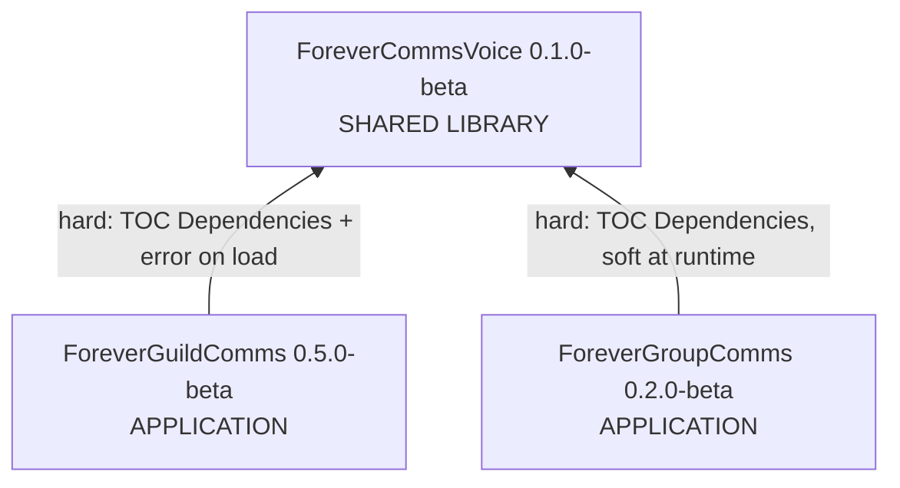

# Component Inventory

**Analysis date**: 2026-10-19T09:52:22Z

This is the project's first genuinely multi-package pass. Earlier passes recorded one
application package; the workspace now holds three distributable addon packages inside
one Git repository.

## Application Packages

| Package | Version | Modules | Lines | Methods | Purpose |
| --- | --- | --- | --- | --- | --- |
| `ForeverGuildComms` | 0.5.0-beta | 9 | 1,557 | 64 | Guild social layer: login greetings, new-member welcomes, level congratulations, automatic-or-verify delivery, private craft and LFG alerts, recipe cache, tabard reminders, help composer, Titan menu, keybindings |
| `ForeverGroupComms` | 0.2.0-beta | 6 | 978 | 47 | Party and dungeon layer: group greetings and congratulations staged for review, coordination calls, native ready checks and a private response tally, target marking, bidirectional quest-log comparison over an opt-in addon protocol, manual quest sharing |

## Infrastructure Packages

None. There is no CDK, Terraform, CloudFormation or container definition anywhere in the
repository. "Deployment" is a file copy into the client's `AddOns` directory.

The closest equivalents are packaging and install tooling, which live inside the
application packages rather than as separate packages:

| Artifact | Location | Purpose |
| --- | --- | --- |
| `package.yml` x3 | `<Addon>/.github/workflows/` | BigWigsMods/packager on a `v*` tag. **Currently inert** — GitHub Actions only reads workflows from the repository root |
| `.pkgmeta` x3 | `<Addon>/` | Packager exclusion lists. Also positioned for a per-addon repository root rather than this monorepo root |
| `Install-ForeverComms.{cmd,ps1}` | `install/` | Combined installer for all three addons, with staging, backup and rollback |
| `Install-Forever<Name>.{cmd,ps1}` x3 | `<Addon>/install/` | Per-addon installers that parse their own TOC and copy only loadable files, `Bindings.xml`, and for GuildComms `Media\Icon.tga` |

## Shared Packages

| Package | Version | Type | Modules | Lines | Methods | Purpose |
| --- | --- | --- | --- | --- | --- | --- |
| `ForeverCommsVoice` | 0.1.0-beta | Library / Models | 7 | 860 | 18 | The only shared package. Owns the per-character voice profile, 8 curated languages, 29 accent phrasebooks, the race-to-accent map, the guild and group phrase catalogs, the locale and accent variant banks, the shuffle bags, and the `Render` pipeline. Declared as a hard `## Dependencies:` entry by both behaviour addons |

Content owned by the shared package:

| Asset | Count |
| --- | --- |
| Languages | 8 — en, es, fr, de, it, pt, pl, nl |
| Accents | 29 — 8 regional English, 13 WoW roleplay voices, 8 regional variants of translated languages |
| Guild message kinds | 4 — login, join, level, help |
| Group message kinds | 13 — greet, welcome, level, roles, quests, pull, mana, regroup, heal, cc, skull, interrupt, request |
| Registered catalog scopes | 2 — guild, group |
| Role and activity label sets | 8 languages each |

## Test Packages

No separate test packages. Each application and shared package carries its own
`tests/` directory, none of which is listed in a TOC or shipped by the packager.

| Location | Harnesses | Lines | Type | Notes |
| --- | --- | --- | --- | --- |
| `ForeverGuildComms/tests/` | 11 | 826 | Unit / integration | `syntax`, `smoke`, `verify`, `settings`, `timing`, `titanmenu`, `voice`, `keybindings`, `icon`, `tabard_dedup`, `variations`. Eight of the eleven now load the sibling `ForeverCommsVoice` folder, so they are cross-package integration tests |
| `ForeverGroupComms/tests/` | 1 | 105 | Integration | `smoke` — roster, roles, level suggestions, quick actions, the full Q/R round trip, sharing, and staleness. Loads Core, Roster and Quests; stubs out UI, Options and Broker |
| `ForeverCommsVoice/tests/` | 1 | 64 | Cross-package integration | `integration` — the only harness that loads **all three** addons and drives both rendering paths against one shared profile |

## Documentation and tooling (non-shipped)

| Location | Purpose |
| --- | --- |
| `aidlc-docs/` | AI-DLC state, audit log and these reverse-engineering artifacts. Documentation only; never loaded |
| `.kiro/steering/` | 8 steering files. All eight are written for the single-addon project and predate the restructure |
| `.kiro/aws-aidlc-rule-details/` | AI-DLC rule detail files |
| `README.md` (root) | 2 lines. There is no bundle-level documentation |
| `LICENSE` | 17 lines, repository root; not duplicated into the packages |

## Total Count

- **Total Packages**: 3
- **Application**: 2 — ForeverGuildComms, ForeverGroupComms
- **Infrastructure**: 0
- **Shared**: 1 — ForeverCommsVoice
- **Test**: 0 as packages; 3 `tests/` directories holding 13 harnesses

### Aggregate

| Metric | Value |
| --- | --- |
| Shipped Lua modules | 22 |
| Shipped Lua lines | 3,395 |
| Public methods | 129 |
| Registered events | 25 across 3 dispatchers |
| Shipped non-Lua runtime files | 3 TOCs, 2 `Bindings.xml`, 1 `Media/Icon.tga` |
| SavedVariables tables | 4 |
| Offline harnesses | 13, 995 lines, 29% of shipped Lua |
| Slash command roots | 3, six aliases total |
| Keybindings | 6, none bound by default |
| Hard inter-package dependency edges | 2, both pointing at ForeverCommsVoice |
| Optional runtime dependencies | LibDataBroker-1.1, Blizzard MenuUtil |
| Embedded third-party libraries | 0 |

## Package relationships

**Text alternative**: Both application packages depend on the shared library and the
library depends on neither of them. GuildComms' dependency is hard in both senses: the
TOC declares it and `VoiceBridge.lua` raises an error if the global is missing.
GroupComms declares the same TOC dependency but its runtime code tolerates the library's
absence by falling back to a built-in English phrase table. There is no dependency
between the two application packages.

## Observations relevant to planning

1. **Nothing is committed yet.** The repository has a single `Initial commit` and the only
   staged file is `.gitattributes`. All three packages, the combined installer,
   `aidlc-docs/` and `.kiro/` are untracked. This pass runs before the first real commit,
   as requested.
2. **Three versions, one tag namespace.** Each package carries an independent version and
   each ships a workflow listening on `v*`. A monorepo cannot express three product
   versions in one unprefixed tag namespace; a prefixing scheme such as
   `voice/v0.1.0-beta` plus root-level workflows would be needed.
3. **Harness distribution is now very uneven.** GuildComms carries 11 of 13 harnesses and
   83% of the test lines. Three of GroupComms' six modules and one of Voice's seven have
   no harness that loads them, and neither new package has a syntax-only harness.
