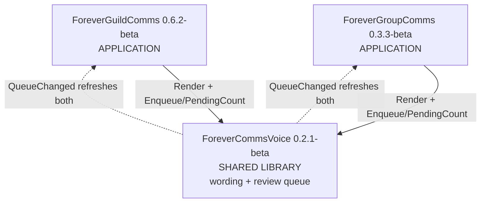

# Component Inventory

**Analysis date**: 2026-10-19T13:30:00Z
**Target**: ForeverCommsVoice 0.2.1-beta, ForeverGroupComms 0.3.3-beta, ForeverGuildComms 0.6.2-beta

## Application Packages

| Package | Version | Modules | Lines | Methods | Purpose |
| --- | --- | --- | --- | --- | --- |
| `ForeverGuildComms` | 0.6.2-beta | 9 | 1,491 | 65 | Guild social layer: login greetings, new-member welcomes, level congratulations, automatic-or-review delivery, private craft and LFG alerts, recipe cache, tabard reminders, help composer, Titan menu, keybindings. Its review backlog now delegates to the shared queue, which is why `UI.lua` shrank 87 lines this span |
| `ForeverGroupComms` | 0.3.3-beta | 7 | 1,108 | 52 | Party and dungeon layer: group greetings and congratulations staged for review, coordination calls, native ready checks and a private response tally, target marking, bidirectional quest comparison, manual quest sharing. **Gained `TitanMenu.lua` this span**, reaching menu parity with GuildComms |

## Shared Packages

| Package | Version | Type | Modules | Lines | Methods | Purpose |
| --- | --- | --- | --- | --- | --- | --- |
| `ForeverCommsVoice` | 0.2.1-beta | Library / Models | 9 | 1,207 | 35 | Two shared capabilities now. **Wording**: the per-character voice profile and its sole writer, 8 languages, 29 accent phrasebooks, the race map, both phrase catalogs, variant banks, shuffle bags, the `Render` pipeline. **Review queue, new this span**: one transient click-to-send backlog shared by both consumers, with its own movable UI |

Content and capability owned by the shared package:

| Asset | Count |
| --- | --- |
| Languages | 8 — en, es, fr, de, it, pt, pl, nl |
| Accents | 29 |
| Guild message kinds | 4 — login, join, level, help |
| Group message kinds | 13 |
| Registered catalog scopes | 2 — guild, group |
| **Review queue sources** | **2 — guild, group** |
| **Queue settings** | **6 — visibleRows, autoSkipSeconds, sourceDisplay, showOnNew, x, y** |

## Infrastructure Packages

None. No CDK, Terraform, CloudFormation or container definition.

Build and install tooling. **The release path changed again this span** — BigWigs is now
the CI pipeline and four offline tools are orphaned while still being documented:

| Artifact | Lines | Status |
| --- | --- | --- |
| `.github/workflows/package.yml` | 39 | **Active.** BigWigsMods/packager with `-d`, then `check_bigwigs_bundle.py`, artifact upload, Release on tag. **No test step** |
| `.pkgmeta` (root) | 37 | **Active, new.** `package-as: ForeverCommsBundle` with `move-folders` lifting the three addons to top level, plus a 24-entry ignore list |
| `tools/check_bigwigs_bundle.py` | 28 | **Active, new.** Asserts exactly three top-level folders, each TOC present, both consumer `Dependencies` lines intact, and no `tests/`/`install/`/`.github/` content |
| `tools/run_tests.py` | 120 | **Orphaned from CI.** The single harness runner; still the documented local command |
| `tools/package.py` | 97 | **Orphaned.** Offline builder, still named as the build command in `PACKAGING.md` line 5 |
| `tools/verify_package.py` | 89 | **Orphaned.** Its TOC-versus-README version check currently **fails** on live drift |
| `package.ps1` / `package.cmd` | 72 / 11 | **Orphaned.** Offline Windows builder |
| `run-tests.cmd` | 15 | Launcher over `run_tests.py` |
| `install/Install-ForeverComms.ps1` + `.cmd` | 153 / 12 | The one real installer: `-Addons` selection, dependency prepending, TOC-derived file lists, staging, backup outside `AddOns`, rollback |
| `<Addon>/install/Install-<Addon>.ps1` x3 | 13 each | Shims delegating to the shared installer |
| `<Addon>/install/Install-<Addon>.cmd` x3 | 31 each | Launchers. **All six version lines are stale** |
| `<Addon>/install/INSTALL-README.txt` x3 | 14-16 | **The ForeverCommsVoice copy still says the library depends on itself** |
| `<Addon>/.pkgmeta` x3 | 7 each | Per-addon packager exclusions, for the standalone-repository case |
| `<Addon>/.github/workflows/package.yml` x3 | 19 each | BigWigs, standalone case only |
| `PACKAGING.md` (root) | 35 | Documents **two** release paths without stating which is authoritative |
| `ForeverGuildComms/PACKAGING.md` | 128 | Re-expanded from the 8-line pointer it was reduced to last span |

## Test Packages

No separate test packages. Each package carries its own `tests/`, none TOC-listed, none
shipped.

| Location | Harnesses | Lines | Status |
| --- | --- | --- | --- |
| `ForeverGuildComms/tests/` | 11 | 828 | **1 failing.** `keybindings.lua` cannot execute — its Lua 5.1 `loadstring` fix was reverted. `syntax.lua` was reverted to a hand-maintained list, losing TOC derivation and `Bindings.xml` coverage. The Restore Defaults regression block was deleted from `settings.lua` |
| `ForeverCommsVoice/tests/` | 4 | 243 | **2 failing.** `queue.lua` and `queue_ui.lua` resolve modules from the **suite root**, against the project convention. `syntax.lua` is TOC-derived and passes. The Expressive regression block was deleted from `integration.lua` |
| `ForeverGroupComms/tests/` | 2 | 144 | Both pass. `syntax.lua` is TOC-derived and also compiles the 3 `Bindings.xml` handlers |

**Suite status: 14 pass, 3 fail, 17 total. Verified by execution.**

## Module coverage

| Package | Covered | No harness loads it |
| --- | --- | --- |
| Voice | 8 of 9, but `Queue`/`QueueUI` only via the two failing harnesses | `Options.lua` |
| GuildComms | all 9 | — |
| GroupComms | `Core`, `Roster`, `Quests` | `UI.lua`, `Options.lua`, `Broker.lua`, **`TitanMenu.lua`** |

Five modules, 468 lines, loaded by nothing — up from four last pass, because the new
`TitanMenu.lua` arrived without a harness while GuildComms' equivalent has had a dedicated
one since 0.4.1.

## Documentation and tooling (non-shipped)

| Location | Purpose |
| --- | --- |
| `aidlc-docs/` | AI-DLC state, audit log and these artifacts |
| `.kiro/steering/` | 9 files. **Stale again**: `testing.md` asserts CI runs the harnesses and expects 13; `release-packaging.md` names `tools/package.py` as the CI builder. The interpreter section added last span remains accurate and valuable |
| `README.md` (root) | 24 lines. Package table, install order, Titan menu and queue notes |
| `LICENSE` | Repository root |

## Total Count

- **Total Packages**: 3
- **Application**: 2 — ForeverGuildComms, ForeverGroupComms
- **Infrastructure**: 0
- **Shared**: 1 — ForeverCommsVoice
- **Test**: 0 as packages; 3 `tests/` directories holding 17 harnesses

### Aggregate

| Metric | Value | Change |
| --- | --- | --- |
| Shipped Lua modules | 25 | +3 |
| Shipped Lua lines | 3,806 | +418 |
| Public methods | 152 | +23 |
| Registered events | 25 across 3 dispatchers | — |
| **`OnUpdate` handlers** | **1** — `Queue.lua:70`, against the project's own rule | +1 |
| SavedVariables tables | 4 | — |
| Offline harnesses | 17, 1,215 lines, 32% of shipped Lua | +4 |
| **Harnesses failing** | **3** | +3 |
| Modules no harness loads | 5 | +1 |
| Active CI workflows | 1 at the repository root | — |
| **CI steps verifying behaviour** | **0** — regressed from 1 | −1 |
| CI steps verifying packaging | 1 — `check_bigwigs_bundle.py` | −4 |
| Release paths present | 3 — BigWigs, Python builder, PowerShell builder | +1 |
| Release paths exercised | 1 | — |
| Stale version strings | 7 | +7 |
| Embedded third-party libraries | 0 | — |

## Package relationships

**Text alternative**: Both applications depend on the shared library, now for two things
rather than one: message wording via `V:Render`, and click-to-send review via `V:Enqueue`
and `V:PendingCount`. The library calls back into whichever consumers are present through
`V:QueueChanged`, which probes `_G.ForeverGuildComms` for `UpdateApprovalsUI` and
`UpdateBroker` and `_G.ForeverGroupComms` for `RefreshUI`. That back-reference was
optional before this span and is now how both consumers learn the queue changed. There is
still no dependency between the two applications.

## Observations relevant to planning

1. **The suite is red and nothing automated would notice.** Three mechanical failures, all
   introduced because the CI test step was removed in the same commit.
2. **The library now owns two shared capabilities.** Adding the queue was the right call —
   it removed parallel implementations and closed a positional-binding finding carried
   since 0.4.1 — but it raises the cost of a breaking library change, since both
   consumers now depend on the library for wording *and* delivery review.
3. **Three release paths, one exercised, documentation pointing at an unexercised one.**
   Decide which is authoritative.
4. **Version drift returned immediately** after the check that prevents it stopped running.
5. **GroupComms is the least-tested package by a wide margin**: 2 harnesses for 7 modules,
   with four of those modules loaded by nothing, while it is the package holding the only
   inbound untrusted-data path in the bundle.
