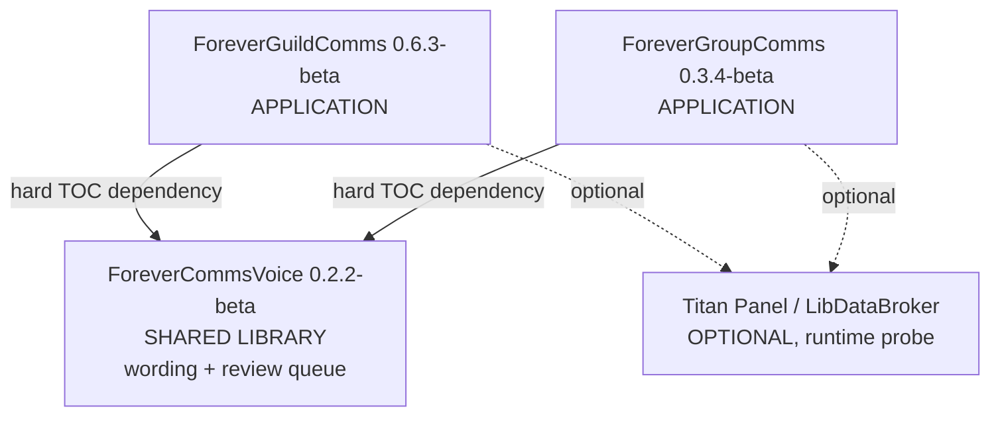

# Component Inventory

**Target**: ForeverCommsVoice 0.2.2-beta, ForeverGroupComms 0.3.4-beta, ForeverGuildComms 0.6.3-beta
**Analysis date**: 2026-10-25T04:00:00Z
**Target commit**: `f7f7bab`

## Application Packages

| Package | Version | Modules | Lines | Methods | Purpose |
| --- | --- | --- | --- | --- | --- |
| `ForeverGuildComms` | 0.6.3-beta | 9 | 1,585 | 68 | Guild social layer: login greetings, new-member welcomes, level congratulations, automatic-or-review delivery, private craft and LFG alerts, recipe cache, tabard reminders, help composer, Titan menu, keybindings |
| `ForeverGroupComms` | 0.3.4-beta | 7 | 1,166 | 53 | Party and dungeon layer: group greetings and congratulations staged for review, coordination calls, native ready checks with a private response tally, target marking, bidirectional quest comparison, manual quest sharing, Titan menu |

## Shared Packages

| Package | Version | Type | Modules | Lines | Methods | Purpose |
| --- | --- | --- | --- | --- | --- | --- |
| `ForeverCommsVoice` | 0.2.2-beta | Library / Models | 9 | 1,242 | 34 | Two shared capabilities. **Wording**: the per-character voice profile and its sole writer, 8 languages, 29 accent phrasebooks, the race map, both phrase catalogs, variant banks, shuffle bags, the `Render` pipeline. **Review queue**: one transient click-to-send backlog shared by both consumers, with its own movable overlay |

## Infrastructure Packages

None. This is a WoW addon bundle; there is no cloud infrastructure, no CDK, no
Terraform, no CloudFormation and no deployable service. "Deployment" is copying folders
into `Interface\AddOns`.

## Test Packages

None as packages. Three `tests/` directories, excluded from every TOC and from every
shipped archive by `.pkgmeta`.

| Location | Harnesses | Lines |
| --- | --- | --- |
| `ForeverCommsVoice/tests/` | 8 | 1,137 |
| `ForeverGuildComms/tests/` | 13 | 1,512 |
| `ForeverGroupComms/tests/` | 7 | 1,714 |
| **Total** | **28** | **4,363** |

## Module inventory

### ForeverCommsVoice — 9 modules, 1,242 lines, 34 methods

| Module | Lines | Methods | Responsibility |
| --- | --- | --- | --- |
| `Core.lua` | 270 | 10 | Namespace, voice profile and its validating writer, legacy migration latch, catalog registry, `V:Format` with the byte clamp, shuffle-bag `V:Pick` and `V:ResetVariantBags`, the `V:Render` dispatcher and its per-scope resolvers |
| `Languages.lua` | 81 | 0 | 8 language definitions and the guild locale template bank |
| `Accents.lua` | 51 | 0 | 29 accent registrations: label, language, four guild templates, flair prefix |
| `RaceProfiles.lua` | 76 | 5 | Race-to-accent map, availability filtering, role and activity localization |
| `MessageVariants.lua` | 202 | 0 | Accent and locale variant banks for guild wording. Declares no namespace state of its own |
| `GroupPhrases.lua` | 144 | 0 | Group/dungeon catalog for 8 languages plus curated per-accent group wordings |
| `Queue.lua` | 148 | 12 | The shared review queue: settings, enqueue, approve, skip, expiry ticker, 100-entry cap |
| `QueueUI.lua` | 136 | 4 | The movable scrollable queue overlay |
| `Options.lua` | 134 | 3 | Settings canvas panel, `/fcv`, and the addon's `ADDON_LOADED` frame |

### ForeverGuildComms — 9 modules, 1,585 lines, 68 methods

| Module | Lines | Methods | Responsibility |
| --- | --- | --- | --- |
| `Core.lua` | 575 | 31 | **Load-time library guard as its first statement**, defaults, helpers, `A:IsSelf`, byte clamp, dedup with pruning, the guild send queue and its spacing, approval staging and the approval floor, the activity-type state, settings writers, the single event dispatcher, `/fgc` |
| `VoiceBridge.lua` | 28 | 6 | Thin forwarders to the library; returns quietly if the library is absent, since `Core.lua` has already refused |
| `Roster.lua` | 123 | 7 | Roster read, baseline capture, diff, the suspicious-read guard, guild-join parsing, polling |
| `Alerts.lua` | 99 | 5 | Guild chat parsing, craft and group detection, recipe cache, the private alert list |
| `Tabard.lua` | 70 | 2 | City detection and tabard reminders via `StaticPopupDialogs` |
| `UI.lua` | 229 | 12 | Alerts window with 7 paged rows, help composer and its preview draft, `A:GetActivityType` |
| `Options.lua` | 294 | 1 | Settings canvas panel |
| `TitanMenu.lua` | 129 | 2 | Nested LibDataBroker/Titan context menu |
| `Broker.lua` | 38 | 2 | Optional LibDataBroker data object |

### ForeverGroupComms — 7 modules, 1,166 lines, 53 methods

| Module | Lines | Methods | Responsibility |
| --- | --- | --- | --- |
| `Core.lua` | 300 | 21 | **Load-time library guard as its first statement**, defaults, helpers, local variant bank, the single send funnel with the 2-second floor, staging and approval with serial checks, rank gate, ready check, target marking, the event dispatcher, `/fgp` |
| `Roster.lua` | 162 | 6 | Group scan, `groupSerial` bump on identity change, greetings and level staging, role counts and issues, ready-check tally |
| `Quests.lua` | 303 | 12 | The quest-sync protocol: parse, packetize, outbox with pacing and bounds, broadcast, completion replies, inbound validation, comparison rows, sharing |
| `UI.lua` | 164 | 6 | Group panel and the quest comparison window with 9 paged rows |
| `Options.lua` | 87 | 2 | Settings canvas panel with the three canvas callbacks |
| `TitanMenu.lua` | 114 | 4 | Nested context menu and status snapshot |
| `Broker.lua` | 36 | 2 | Optional LibDataBroker data object |

## Harness inventory

### ForeverCommsVoice

| Harness | Lines | Covers |
| --- | --- | --- |
| `bytelimit.lua` | 199 | The 250-byte UTF-8 clamp in **all three** implementations, 2/3/4-byte characters, 138 checks |
| `expressive.lua` | 121 | The accent-strength scope matrix across both scopes |
| `integration.lua` | 80 | Cross-package rendering, migration, shuffle bags, both adapters |
| `options.lua` | 303 | The Settings panel, queue settings, and the `ADDON_LOADED` registration gate |
| `parity.lua` | 120 | The three duplicated message tables, plus the behaviour they protect |
| `queue.lua` | 135 | The shared queue end to end, including the 100-entry cap |
| `queue_ui.lua` | 67 | The queue overlay |
| `syntax.lua` | 28 | TOC-derived compile check |

### ForeverGuildComms

| Harness | Lines | Covers |
| --- | --- | --- |
| `alertsui.lua` | 252 | Alerts window paging, row reuse, whisper targeting, Review count |
| `roster.lua` | 213 | `A:IsSelf` matrix, baseline, the suspicious-read guard |
| `titanmenu.lua` | 176 | Nested menu, Titan/Settings synchronisation, fallbacks |
| `verify.lua` | 132 | Approval flow, mode switches, guild change, approval floor, 30-entry cap |
| `settings.lua` | 126 | Settings panel, SavedVariables migration, Restore Defaults scope |
| `tabard_dedup.lua` | 117 | Tabard reminder deduplication |
| `variations.lua` | 100 | Message variety and shuffle behaviour |
| `smoke.lua` | 79 | Roster diff, self-exclusion, alerts, recipe cache |
| `keybindings.lua` | 65 | `Bindings.xml` handlers against the 5.1 dialect |
| `timing.lua` | 59 | Timing clamps |
| `voice.lua` | 53 | Voice delegation and option validation |
| `syntax.lua` | 44 | TOC-derived compile check plus `Bindings.xml` handlers |
| `icon.lua` | 23 | Icon asset presence |

### ForeverGroupComms

| Harness | Lines | Covers |
| --- | --- | --- |
| `ui.lua` | 350 | Group panel, quest window paging, Settings canvas callbacks |
| `outbox.lua` | 307 | Pacing, 60-entry cap, 12-chunk refusal, cancellation token, `questSync` opt-out |
| `safety.lua` | 285 | The 2-second floor, `groupSerial` rejection, rank gate, `Notify` dedup and cap |
| `titanmenu.lua` | 283 | Nested menu, every toggle's key, rank and grouping gates |
| `protocol.lua` | 273 | ~50 malformed and hostile addon-message payloads |
| `smoke.lua` | 105 | Roster, roles, quick actions, Q/R round trip, sharing |
| `syntax.lua` | 43 | TOC-derived compile check plus `Bindings.xml` handlers |

## Build and release tooling

| Tool | Purpose |
| --- | --- |
| `tools/run_tests.py` | The single harness runner. Discovers `tests/*.lua` per package; CI and local use the same command |
| `tools/package.py` | Local mirror of BigWigs, reading the **same root `.pkgmeta`**. `--source` builds the installer-bearing archives |
| `tools/check_bigwigs_bundle.py` | Release gate for both paths: archive structure, runtime completeness, version consistency across four locations per package |
| `tools/verify_package.py` | Verifies the `--source` archives only |
| `tools/fault_inject.py` | Mutation check: reverts one guard at a time and confirms a harness fails. Developer tool, deliberately not in CI |
| `tools/check_lua_quality.py` | **The CI quality gate.** Resolves and validates `lua5.1`, `luac5.1` and `luacheck`; strict-parses every `.lua`; runs `run_tests.py`; demands a zero-warning luacheck |
| `wiki/` | 9 pages, 1,530 lines of user documentation. Excluded from every archive |
| `LUA51-AUDIT.md`, `Lua51-Test-Results.txt` | Engineering records of the Lua 5.1 quality work |
| `package.ps1` / `package.cmd` | Windows launcher over `tools/package.py` |
| `run-tests.cmd` | Windows launcher over `tools/run_tests.py` |
| `.luacheckrc` | Linter configuration for all three packages |
| `.pkgmeta` (root) | The single source of truth for what ships |
| `.github/workflows/package.yml` | Checkout, install Lua 5.1, run all harnesses, BigWigs build, structure check, artifact upload, Release on a tag |

## Total Count

- **Total Packages**: 3
- **Application**: 2 — ForeverGuildComms, ForeverGroupComms
- **Infrastructure**: 0
- **Shared**: 1 — ForeverCommsVoice
- **Test**: 0 as packages; 3 `tests/` directories holding 28 harnesses

### Aggregate

| Measure | Value |
| --- | --- |
| Shipped Lua modules | 25 |
| Shipped Lua lines | 3,993 |
| Public methods | 155 |
| Offline harnesses | 28 |
| Harness lines | 4,363 (109% of shipped) |
| Event dispatchers | 3, one per addon |
| Registered events | 25 |
| SavedVariables tables | 4 |
| Modules loaded by no harness | 0 |

