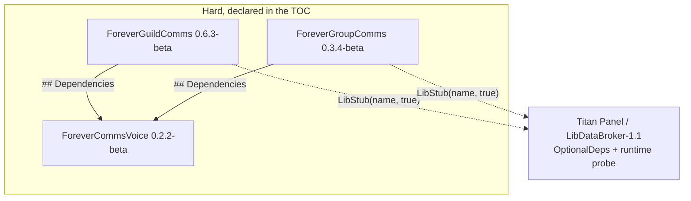

# Dependencies

**Target**: ForeverCommsVoice 0.2.2-beta, ForeverGroupComms 0.3.4-beta, ForeverGuildComms 0.6.3-beta
**Analysis date**: 2026-10-25T02:30:00Z
**Target commit**: `a64ac2a`

## Internal Dependencies

### ForeverGuildComms depends on ForeverCommsVoice

- **Type**: Runtime, hard. `## Dependencies: ForeverCommsVoice` in the TOC.
- **Reason**: all wording — languages, accents, race filtering, message variation — and
  the shared review queue live in the library. `VoiceBridge.lua` is a 24-line set of
  forwarders; `A:CommsText` is the single indirection the rest of the addon calls.
- **Effect if absent**: the client refuses to load the addon.

### ForeverGroupComms depends on ForeverCommsVoice

- **Type**: Runtime, hard. `## Dependencies: ForeverCommsVoice` in the TOC.
- **Reason**: group and dungeon wording for 8 languages, plus the shared review queue.
- **Effect if absent**: the client refuses to load the addon.
- **Note**: GroupComms retains a complete local English variant bank (`A.variants`) and a
  `useSharedVoice` setting, so it can be switched back to its original wording at
  runtime. That table and the library's `groupTemplates.en` are duplicated deliberately
  and are now asserted entry-by-entry by `ForeverCommsVoice/tests/parity.lua`.

### ForeverCommsVoice depends on nothing

Root of the graph. It has no `## Dependencies` line and no `## OptionalDeps`.

### Version coupling

`## Dependencies` guarantees **presence, not version**. There is no negotiation
mechanism, so a breaking change to the `V:Render` options contract or the `V:Enqueue`
record shape requires bumping and releasing all three packages together. Both consumer
READMEs state the library version they were built against — currently
**ForeverCommsVoice 0.2.2-beta** — and that line is part of the documented bump checklist.

## External Dependencies

### Runtime

| Dependency | Version | Purpose | Hardness | License |
| --- | --- | --- | --- | --- |
| WoW Forever client API | 1.60.1 / Interface `16001` | The entire runtime: frames, chat, roster, quests, timers, settings | **Required** | Proprietary (Blizzard) |
| Titan Panel | any providing LibDataBroker-1.1 | A broker button with a nested right-click menu | **Optional**, probed with `LibStub("LibDataBroker-1.1", true)` | Open source, not vendored |
| Blizzard `MenuUtil` | client-provided | Nested context menus | Optional, feature-probed; falls back to opening Settings | Proprietary |

**Nothing is vendored.** No `Libs/` directory, no `embeds.xml`, no `externals` block in
any `.pkgmeta`. Titan integration deliberately uses Titan's own LibDataBroker copy rather
than shipping a second one, which is why Titan appears under `OptionalDeps` and never
under `Dependencies`.

### Feature-probed client APIs

Because the target is a beta client, every non-trivial API is checked before use. The
fallback behaviour is part of the contract:

| API | Fallback when absent |
| --- | --- |
| `C_GuildInfo.GuildRoster` | Skip the explicit roster request; rely on the event and ticker |
| `C_PartyInfo.DoReadyCheck` | Bare `DoReadyCheck`, then refuse with a message |
| `SetRaidTarget` | `SetRaidTargetIcon`, then refuse with a message |
| `C_QuestLog.GetNumQuestLogEntries` / `GetInfo` | Legacy `GetNumQuestLogEntries` / `GetQuestLogTitle` |
| `C_QuestLog.IsQuestFlaggedCompleted` | Send no completion reply at all |
| `C_QuestLog.IsPushableQuest` | Shareability reported as unknown rather than assumed |
| `C_ChatInfo.RegisterAddonMessagePrefix` | `questCommsReady` stays false; sending disabled, receiving unaffected |
| `Settings.RegisterCanvasLayoutCategory` | `InterfaceOptions_AddCategory` |
| `Settings.OpenToCategory` | `InterfaceOptionsFrame_OpenToCategory`, called twice |
| `UnitIsGroupLeader` / `UnitIsGroupAssistant` | **Deny.** Rank checks fail closed |
| `MenuUtil.CreateContextMenu` | Open the Settings panel instead |
| `PlaySound` / `SOUNDKIT` | Silent |
| `math.randomseed` | **Does not exist in the client.** Never called; the client seeds the RNG itself at startup |

### Build and development

| Dependency | Version | Purpose | Required for |
| --- | --- | --- | --- |
| Lua interpreter | **5.1** | Running the 28 offline harnesses | Testing |
| Python | 3 | The five `tools/*.py` scripts | Testing, packaging |
| luacheck | 1.2.0 | Static analysis against the root `.luacheckrc` | Linting, not yet in CI |
| BigWigsMods/packager | `@v2` | The authoritative GitHub release path | Releases |
| GitHub Actions | — | Runs the suite, then the packager | CI |
| PowerShell | 5.1+ | The four Windows installers | Manual installation |

None of these ship to users. `.pkgmeta` excludes `tests`, `install`, `.github` and
`PACKAGING.md` from every archive.

## Dependency risks

| Risk | Assessment |
| --- | --- |
| **Hard library dependency breaks both consumers** | Real but accepted. A missing or mismatched `ForeverCommsVoice` means the client refuses to load GuildComms and GroupComms. Mitigated by bundling all three in every archive, by the combined installer prepending the library to any consumer selection, and by both per-package installers refusing rather than producing an unloadable addon |
| **No version negotiation** | A breaking library change must be released as all three packages together. Documented in `release-packaging.md`; nothing enforces it mechanically |
| **Beta client API churn** | Every non-trivial API is probed, with the fallbacks tabled above. Rank checks and send paths fail closed |
| **Duplicated tables drifting** | Two pairs are load-bearing. Both are now asserted by `parity.lua`, which also pins the behaviour the parity protects — a drifted guild default would make every untouched template look like a user edit and silently stop translation |
| **Three copies of the byte clamp** | Deliberate, so each package works standalone. All three are asserted together by `bytelimit.lua` across 2-, 3- and 4-byte characters |
| **Titan absent** | No effect. Both addons are fully functional without a broker |
| **Live client never exercised** | **Unmitigated.** This is the largest open risk in the project and no offline work addresses it |
