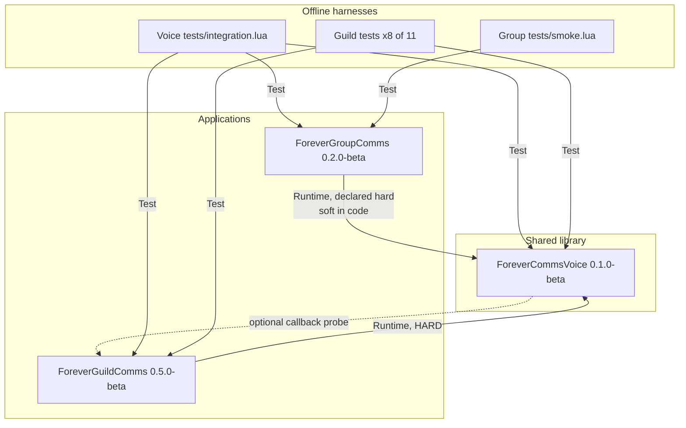

# Dependencies

**Analysis date**: 2026-10-19T09:52:22Z

## Internal Dependencies

**Text alternative**: Both application packages depend on the shared library at runtime.
The library has no outbound package dependency, but it opportunistically probes the
GuildComms global to refresh that addon's options panel after a shared setting changes.
For testing, Voice's single harness depends on all three packages, eight of GuildComms'
eleven harnesses depend on the Voice source folder, and GroupComms' single harness
depends only on GroupComms.

### ForeverGuildComms depends on ForeverCommsVoice
- **Type**: Runtime, hard.
- **Declaration**: `## Dependencies: ForeverCommsVoice` in `ForeverGuildComms.toc`.
- **Enforcement**: twofold. The client refuses to load an addon whose declared dependency
  is missing or disabled. Independently, `VoiceBridge.lua` line 4 reads
  `local V = _G.ForeverCommsVoice` and calls
  `error("ForeverGuildComms requires ForeverCommsVoice")` when it is nil.
- **Reason**: four modules — `Languages.lua`, `Accents.lua`, `RaceProfiles.lua` and
  `MessageVariants.lua`, roughly 465 lines — were removed from GuildComms and now live in
  the library. GuildComms' entire outgoing wording path, including the Settings and Titan
  menu voice controls, is served from there.
- **Coupling surface**: one module, 26 lines, 7 forwarded methods and 12 aliased data
  tables. `Options.lua` and `TitanMenu.lua` required no edits because the aliases
  preserve the old field names.
- **Failure mode**: install or update GuildComms without the library and the addon does
  not load. Neither GuildComms' own installer nor its `INSTALL-README.txt` mentions the
  library; see the risk table below.

### ForeverGroupComms depends on ForeverCommsVoice
- **Type**: Runtime; declared hard, implemented soft.
- **Declaration**: `## Dependencies: ForeverCommsVoice` in `ForeverGroupComms.toc`.
- **Enforcement**: the client's TOC check only. `Core.lua` does not error; `A:Render`
  tests `self.db.useSharedVoice and _G.ForeverCommsVoice` and falls through to the local
  `A.variants` English table when either is false.
- **Reason**: the library supplies eight languages and 29 accents for the 13 group message
  kinds that GroupComms would otherwise have only in English.
- **Coupling surface**: two call sites — `V:Render("group", ...)` in `Core.lua` and
  `V:OpenOptions()` from the Settings button in `Options.lua`.
- **Note**: the soft fallback is also the user-facing opt-out, the
  `useSharedVoice` setting documented as "Disable for original English messages". The TOC
  is nonetheless stricter than the code: the declared dependency means GroupComms will
  not load without the library even though its runtime path tolerates the absence.

### ForeverCommsVoice depends on ForeverGuildComms
- **Type**: Runtime, optional, probe-only.
- **Declaration**: none. The library's TOC declares no dependencies.
- **Reason**: when `V:SetOption` changes a shared value from the `/fcv` panel, GuildComms'
  own Settings controls and help-request preview would otherwise be stale. `V:SetOption`
  probes `_G.ForeverGuildComms` and calls `RefreshOptions` and `UpdateRequestPreview` when
  present.
- **Direction note**: this is a back-reference from a library to one specific consumer.
  GroupComms receives no equivalent callback — its panel re-reads settings on `OnShow`
  instead. The asymmetry is a small design wart, not a defect.

### Intra-package load-order dependencies
`Core.lua` must load first in each package because it declares the namespace and the
state that later files index. Every forward call across modules is guarded, for example
`if self.BuildUI then self:BuildUI() end` and `if A.OnGuildChat then A:OnGuildChat(...)`,
so a stripped install missing a feature file degrades rather than erroring. Two
exceptions to pure guarding exist and are intentional:

| Dependency | Reason it is unguarded |
| --- | --- |
| `GroupPhrases.lua` calling `V:RegisterCatalog` at file scope | The method is defined in `Core.lua`, which the TOC guarantees has already loaded |
| `Languages.lua` reading `A.defaults.templates` at file scope | Same guarantee; the English guild catalog *is* the defaults table |

### Test-time dependencies
- Eight of GuildComms' eleven harnesses resolve the library by
  `os.getenv("FOREVER_VOICE_PATH")` or the relative fallback `../ForeverCommsVoice/`, then
  load six Voice modules before loading `VoiceBridge.lua`.
- Voice's `integration.lua` reaches *sideways* into both sibling packages with
  `../ForeverGroupComms/Core.lua` and `../ForeverGuildComms/Core.lua`.
- Consequence: the harnesses now require the bundle checkout layout. A package extracted
  and tested on its own will fail to load, with the `FOREVER_VOICE_PATH` override as the
  only escape hatch — and no equivalent override exists for the two sibling paths in
  Voice's harness.

## External Dependencies

### WoW Forever client API
- **Version**: 1.60.1, Interface `16001`.
- **Purpose**: the runtime. Every non-pure-Lua call.
- **License**: not applicable; a host platform, not a redistributed dependency.
- **Acquisition**: none. Never vendored, never version-checked beyond the TOC number.
- **Mitigation**: feature detection at every call site plus `pcall` around every
  protected call that can error.

### LibDataBroker-1.1
- **Version**: whichever copy Titan Panel embeds, typically Titan Panel 9.3.5's.
- **Purpose**: the optional panel indicator in both behaviour addons.
- **Usage**: `LibStub("LibDataBroker-1.1", true)` in `ForeverGuildComms/Broker.lua` and
  `ForeverGroupComms/Broker.lua`. The `true` silent flag means a missing library returns
  nil rather than erroring, and both `TryBroker` methods return immediately.
- **License**: not applicable — nothing is redistributed.
- **Declaration**: `## OptionalDeps: Titan` in both application TOCs. The Voice TOC
  declares no optional dependency, correctly, since the library has no UI indicator.

### Blizzard MenuUtil
- **Version**: whatever the client ships.
- **Purpose**: the nested right-click menu in `ForeverGuildComms/TitanMenu.lua`.
- **Usage**: `if not MenuUtil or not MenuUtil.CreateContextMenu then` prints a notice and
  opens the Settings page instead.
- **License**: not applicable; a client API.

### Blizzard Settings API
- **Purpose**: the three Settings canvas panels.
- **Usage**: `Settings.RegisterCanvasLayoutCategory` with `InterfaceOptions_AddCategory`
  as the fallback in Voice and GroupComms. GuildComms is stricter — `BuildOptions` returns
  early with a printed notice if the modern API is absent, so on such a client GuildComms
  has no options page at all while the other two fall back to the legacy panel.

### BigWigsMods/packager
- **Version**: `@v2` GitHub Action.
- **Purpose**: build and publish a release ZIP on a `v*` tag.
- **License**: the action's own; nothing is redistributed into the addons.
- **Usage**: three workflow files, one per package. **None currently executes** — see the
  risk table.

### Lua 5.1 standard library
- **Purpose**: `string`, `table`, `math`, iteration, `pcall`, conversions. `wipe` and
  `date` are WoW-provided rather than standard.
- **Constraint**: LuaJIT extensions are deliberately avoided so harness code cannot come
  to depend on something the client lacks.

## Vendored code

**None.** No `Libs/`, no `embeds.xml`, no `.pkgmeta` `externals` block in any of the three
packages. Every third-party capability is probed at runtime through an API the client or
another addon already provides. This keeps the bundle free of license-compatibility
questions and of embedded-library version conflicts with other installed addons.

## Dependency risks introduced by the restructure

| # | Risk | Severity | Detail |
| --- | --- | --- | --- |
| 1 | No version negotiation across the new package boundary | Medium | Neither consumer reads `V.version` before calling `V:Render`. The client's `## Dependencies:` check verifies presence, not version. A user who updates GuildComms to 0.5.0 but keeps a future incompatible Voice build gets a runtime error inside the library rather than a load-time refusal |
| 2 | Per-addon installers do not install or check the dependency | **High** | `Install-ForeverGuildComms.ps1` copies only files listed in `ForeverGuildComms.toc` plus `Bindings.xml` and `Media\Icon.tga`. Neither it nor `Install-ForeverGroupComms.ps1` contains the string `ForeverCommsVoice` anywhere. A user who runs the GuildComms installer over an existing 0.4.3 install gets a GuildComms that will not load. `ForeverGuildComms/INSTALL-README.txt` and the README install section do not mention the new requirement either. The combined root installer is correct, and the Voice `INSTALL-README.txt` does advise installing Voice first, but nothing stops the per-addon path |
| 3 | Three packaging workflows are inert | **High** | GitHub Actions reads workflows only from `.github/workflows` at the repository root. All three live in package subdirectories and the root has no `.github` directory. The same misplacement applies to the three `.pkgmeta` files, which the packager expects at the checkout root. Tag-driven release packaging is therefore non-functional for the whole bundle |
| 4 | One tag namespace cannot express three versions | Medium | All three workflows trigger on `v*`, and the three packages are at 0.1.0, 0.2.0 and 0.5.0. Even with the workflows relocated, an unprefixed `v*` tag is ambiguous. A prefixed scheme such as `voice/v0.1.0-beta` with one workflow per package, or a single bundle version, is needed |
| 5 | Dead legacy path inside the library | Low | `V:VoiceText` in `RaceProfiles.lua` reads `self.db`, which the library never assigns, so it silently returns `""`. It is reachable only if some future consumer assigns `V.db`, at which point it would bypass `V:Render` and the scope/catalog system entirely |
| 6 | English group phrases duplicated across a package boundary | Low | `ForeverGroupComms/Core.lua` `A.variants` and `ForeverCommsVoice/GroupPhrases.lua` `groupTemplates.en` hold the same 13 phrase lists, verbatim. The duplication is deliberate — it is the fallback that makes `useSharedVoice` possible — but there is no test asserting the two stay in sync, so they can drift silently |
| 7 | GuildComms requires the modern Settings API absolutely | Low | Pre-existing, not introduced here, but now inconsistent across the bundle: Voice and GroupComms fall back to `InterfaceOptions_AddCategory` while GuildComms returns early and has no panel |

## Dependency inventory summary

| Category | Count | Items |
| --- | --- | --- |
| Internal package dependencies | 2 | Guild to Voice, Group to Voice |
| Internal optional back-references | 1 | Voice to Guild, probe only |
| Vendored third-party libraries | 0 | — |
| Runtime-probed third-party libraries | 1 | LibDataBroker-1.1 |
| Host platform APIs | 1 | WoW Forever 1.60.1, Interface 16001 |
| Build-time dependencies | 2 | BigWigsMods/packager@v2, actions/checkout@v4 |
| Test-time dependencies | 1 | A Lua 5.1 interpreter, **not installed on this machine** |
