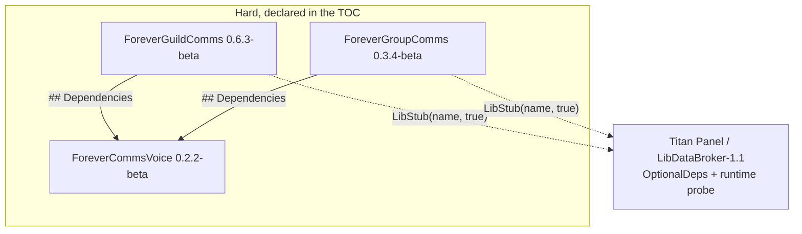

# Dependencies

**Target**: ForeverCommsVoice 0.2.2-beta, ForeverGroupComms 0.3.4-beta, ForeverGuildComms 0.6.3-beta
**Analysis date**: 2026-10-25T04:00:00Z
**Target commit**: `f7f7bab`

## Internal Dependencies



### ForeverGuildComms depends on ForeverCommsVoice

- **Type**: Runtime, hard. `## Dependencies: ForeverCommsVoice` in the TOC **and** a
  load-time guard.
- **Reason**: all wording — languages, accents, race filtering, message variation — and
  the shared review queue live in the library. `VoiceBridge.lua` is a 28-line set of
  forwarders; `A:CommsText` is the single indirection the rest of the addon calls.
- **Effect if absent**: the client refuses to load the addon. If the library is present
  but failed to initialise, `Core.lua` refuses at its first statement (see below).

### ForeverGroupComms depends on ForeverCommsVoice

- **Type**: Runtime, hard. `## Dependencies: ForeverCommsVoice` in the TOC **and** a
  load-time guard.
- **Reason**: group and dungeon wording for 8 languages, plus the shared review queue.
- **Effect if absent**: as above.
- **Note**: GroupComms retains a complete local English variant bank (`A.variants`) and a
  `useSharedVoice` setting, so a player can switch back to the original wording at
  runtime. That is a **preference**, not a fallback for a missing library — the addon
  refuses to load without the library regardless of the setting. `A.variants` and the
  library's `groupTemplates.en` are duplicated deliberately so the local path works, and
  are asserted entry-by-entry by `ForeverCommsVoice/tests/parity.lua`.

### The load-time guard

Both consumers' `Core.lua` now open with:

```lua
if not _G.ForeverCommsVoice then
    error("Forever<X>Comms requires ForeverCommsVoice. Install the Forever Comms " ..
          "bundle, or enable ForeverCommsVoice in the AddOns list.")
end
```

**Why, given the TOC already declares the dependency.** `## Dependencies` makes the client
decline to load the addon when the library is missing or disabled. It cannot see the
narrower case where the library *was* loaded but failed partway through, leaving
`_G.ForeverCommsVoice` unset — the dependency is satisfied as far as the client is
concerned, and the consumer then runs against a missing library.

**Why it is the first statement.** Erroring there means the namespace global is never
published, the event dispatcher at the bottom of the file is never created, and the
`Bindings.xml` handlers find nil, so the addon goes inert with one clear message. Both
previous arrangements were weaker: GroupComms had no check at all and degraded silently,
and GuildComms checked from `VoiceBridge.lua`, the second TOC file, by which point
`Core.lua` had finished — the dispatcher existed and `ADDON_LOADED` still reached
`A:Initialize()`, so the addon half-ran and failed later at render time.

**Why degrading was not acceptable.** With the library absent, GroupComms' `A:Stage` falls
back to the local approval list, and that list's `A:Approve` calls
`A:Send(entry.kind, entry.vars)`, which **re-renders** instead of replaying the captured
text. With `randomMessages` on, the message sent could differ from the one the player
reviewed — a violation of "the Send button must send exactly the wording shown in the
preview". The degraded mode was not merely reduced, it was incorrect.

Because a Lua error in one TOC file does not stop the client loading the rest,
`VoiceBridge.lua` is still reached in that state; it returns quietly rather than raising a
second error about the same cause.

Asserted by regression blocks in `ForeverGuildComms/tests/verify.lua` and
`ForeverGroupComms/tests/safety.lua`, and by three entries in `tools/fault_inject.py`.

### Why the library is not embedded

Considered and **rejected**; recorded as item 45 in `SUGGESTED-CHANGES.md`. The
conventional WoW answer to a hard dependency is to vendor the library under `Libs/` with
LibStub, so each consumer ships its own copy. That does not work here:

- **`ForeverCommsVoice` declares `## SavedVariablesPerCharacter`** and persists both the
  voice profile and the queue settings there. An embedded library is loaded through the
  consumer's TOC, has no TOC of its own, and therefore cannot declare SavedVariables —
  only addons can. The shared state would have to live in a consumer's database, which
  breaks the "never let one package write another's table" invariant and makes
  `A.char.voice` and `ForeverCommsVoiceCharDB.voice` being the *same table object* either
  impossible or very fragile.
- **Install order would decide ownership.** Install one consumer, then the other months
  later, and a second bidirectional migration is needed alongside the existing latched
  `V:MigrateLegacy`.
- **The library owns user-facing surfaces** — `/fcv`, a Settings AddOn category and a
  named window. With two embedded copies, which one registers them becomes a load-order
  accident.
- **It would trade an enforced rule for a disciplined one.** Today a breaking `V:Render`
  contract change means releasing all three packages together, enforced by the release
  process. LibStub would replace that with within-name backward compatibility, enforced
  only by care.
- **The problem it would solve is already solved** at the distribution layer: the root
  `.pkgmeta` bundles all three folders in every archive, and the combined installer
  prepends the library to any consumer-only selection, so a library-less install is
  unreachable.

### ForeverCommsVoice depends on nothing

Root of the graph. It has no `## Dependencies` line and no `## OptionalDeps`.

### Version coupling

`## Dependencies` guarantees **presence, not version**. There is no negotiation
mechanism, so a breaking change to the `V:Render` options contract or the `V:Enqueue`
record shape requires bumping and releasing all three packages together. Both consumer
READMEs state the library version they were built against — currently
**ForeverCommsVoice 0.2.2-beta** — and that line is part of the documented bump checklist.

## External Dependencies

### Runtime

| Dependency | Version | Purpose | Hardness | License |
| --- | --- | --- | --- | --- |
| WoW Forever client API | 1.60.1 / Interface `16001` | The entire runtime: frames, chat, roster, quests, timers, settings | **Required** | Proprietary (Blizzard) |
| Titan Panel | any providing LibDataBroker-1.1 | A broker button with a nested right-click menu | **Optional**, probed with `LibStub("LibDataBroker-1.1", true)` | Open source, not vendored |
| Blizzard `MenuUtil` | client-provided | Nested context menus | Optional, feature-probed; falls back to opening Settings | Proprietary |

**Nothing is vendored.** No `Libs/` directory, no `embeds.xml`, no `externals` block in
any `.pkgmeta`. Titan integration deliberately uses Titan's own LibDataBroker copy rather
than shipping a second one, which is why Titan appears under `OptionalDeps` and never
under `Dependencies`.

### Feature-probed client APIs

Because the target is a beta client, every non-trivial API is checked before use. The
fallback behaviour is part of the contract:

| API | Fallback when absent |
| --- | --- |
| `C_GuildInfo.GuildRoster` | Skip the explicit roster request; rely on the event and ticker |
| `C_PartyInfo.DoReadyCheck` | Bare `DoReadyCheck`, then refuse with a message |
| `SetRaidTarget` | `SetRaidTargetIcon`, then refuse with a message |
| `C_QuestLog.GetNumQuestLogEntries` / `GetInfo` | Legacy `GetNumQuestLogEntries` / `GetQuestLogTitle` |
| `C_QuestLog.IsQuestFlaggedCompleted` | Send no completion reply at all |
| `C_QuestLog.IsPushableQuest` | Shareability reported as unknown rather than assumed |
| `C_ChatInfo.RegisterAddonMessagePrefix` | `questCommsReady` stays false; sending disabled, receiving unaffected |
| `Settings.RegisterCanvasLayoutCategory` | `InterfaceOptions_AddCategory` |
| `Settings.OpenToCategory` | `InterfaceOptionsFrame_OpenToCategory`, called twice |
| `UnitIsGroupLeader` / `UnitIsGroupAssistant` | **Deny.** Rank checks fail closed |
| `MenuUtil.CreateContextMenu` | Open the Settings panel instead |
| `PlaySound` / `SOUNDKIT` | Silent |
| `math.randomseed` | **Does not exist in the client.** Never called; the client seeds the RNG itself at startup |

### Build and development

| Dependency | Version | Purpose | Required for |
| --- | --- | --- | --- |
| Lua interpreter | **5.1** | Running the 28 offline harnesses | Testing |
| Python | 3 | The five `tools/*.py` scripts | Testing, packaging |
| luacheck | 1.2.0 | Static analysis against the root `.luacheckrc` | **CI-required.** The build fails on any warning |
| `luac5.1` | 5.1.5 | Strict dialect parse of every `.lua` file | **CI-required** |
| BigWigsMods/packager | `@v2` | The authoritative GitHub release path | Releases |
| GitHub Actions | — | Runs the suite, then the packager | CI |
| PowerShell | 5.1+ | The four Windows installers | Manual installation |

None of these ship to users. `.pkgmeta` excludes `tests`, `install`, `.github` and
`PACKAGING.md` from every archive.

## Dependency risks

| Risk | Assessment |
| --- | --- |
| **Hard library dependency breaks both consumers** | Real and deliberately accepted. A missing `ForeverCommsVoice` means the client refuses to load either consumer, and a library that loaded but failed means each consumer's `Core.lua` refuses at its first statement. Mitigated by bundling all three in every archive, by the combined installer prepending the library to any consumer selection, and by both per-package installers refusing rather than producing an unloadable addon. The alternative — degrading to English-only wording — was rejected because it is incorrect, not merely reduced: the fallback approval path re-renders instead of replaying the reviewed text |
| **No version negotiation** | A breaking library change must be released as all three packages together. Documented in `release-packaging.md`; nothing enforces it mechanically |
| **Beta client API churn** | Every non-trivial API is probed, with the fallbacks tabled above. Rank checks and send paths fail closed |
| **Duplicated tables drifting** | Two pairs are load-bearing. Both are now asserted by `parity.lua`, which also pins the behaviour the parity protects — a drifted guild default would make every untouched template look like a user edit and silently stop translation |
| **Three copies of the byte clamp** | Deliberate, so each package works standalone. All three are asserted together by `bytelimit.lua` across 2-, 3- and 4-byte characters |
| **Titan absent** | No effect. Both addons are fully functional without a broker |
| **Live client never exercised** | **Unmitigated.** This is the largest open risk in the project and no offline work addresses it |
