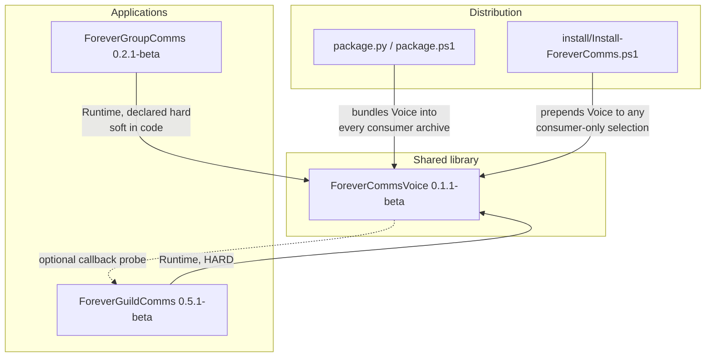

# Dependencies

**Analysis date**: 2026-10-19T11:30:00Z
**Target**: ForeverCommsVoice 0.1.1-beta, ForeverGroupComms 0.2.1-beta, ForeverGuildComms 0.5.1-beta

## Internal Dependencies

**Text alternative**: Both application packages depend on the shared library at runtime and
the library has no outbound package dependency, though it opportunistically probes the
GuildComms global to refresh that addon's options panel. New this span: the dependency is
also enforced by the distribution layer — the builders place a complete copy of
ForeverCommsVoice inside each consumer's release archive, and the installer prepends it to
any selection that names a consumer without it.

### ForeverGuildComms depends on ForeverCommsVoice
- **Type**: Runtime, hard.
- **Declaration**: `## Dependencies: ForeverCommsVoice` in `ForeverGuildComms.toc`.
- **Enforcement**: now fourfold.
  1. The client refuses to load an addon whose declared dependency is missing or disabled.
  2. `VoiceBridge.lua` calls `error("ForeverGuildComms requires ForeverCommsVoice")` if
     the global is nil.
  3. **New** — every `ForeverGuildComms-*.zip` the builders produce contains a complete
     `ForeverCommsVoice/` tree. Verified this pass: 17 `ForeverCommsVoice/` members in the
     source archive, 9 in the `--runtime` archive.
  4. **New** — `install/Install-ForeverComms.ps1` prepends `ForeverCommsVoice` to the
     install list whenever a consumer is selected, and installs in canonical dependency
     order, so the 13-line `Install-ForeverGuildComms.ps1` shim cannot produce a
     Voice-less installation.
- **Reason**: four modules, roughly 465 lines, were moved into the library. GuildComms'
  entire outgoing wording path is served from there.
- **Coupling surface**: one module, 26 lines, 7 forwarded methods and 12 aliased data
  tables. **Reduced this span**: `A:SetVoiceOption` in `Core.lua` went from 27 lines of
  independent validation and direct mutation of the shared table to a 7-line delegation to
  `V:SetOption`, so the library is now the sole writer of the shared profile and the
  duplicate validator is gone.
- **Residual**: `A.char.voice` and `ForeverCommsVoiceCharDB.voice` remain the **same table
  object** at runtime. That is by design, but it is why `panel.OnDefault` could previously
  reset another addon's settings. The write path is now funnelled; the aliasing itself is
  unchanged.

### ForeverGroupComms depends on ForeverCommsVoice
- **Type**: Runtime; declared hard, implemented soft.
- **Declaration**: `## Dependencies: ForeverCommsVoice` in `ForeverGroupComms.toc`.
- **Enforcement**: the client's TOC check, plus the two new distribution-layer guarantees.
  `Core.lua` does not error; `A:Render` tests
  `self.db.useSharedVoice and _G.ForeverCommsVoice` and falls through to the local
  `A.variants` English table when either is false.
- **Coupling surface**: two call sites — `V:Render("group", ...)` in `Core.lua` and
  `V:OpenOptions()` from the Settings button in `Options.lua`.
- **Note**: the soft fallback is also the user-facing `useSharedVoice` opt-out. The TOC is
  nonetheless stricter than the code: GroupComms will not load without the library even
  though its runtime path tolerates the absence.

### ForeverCommsVoice depends on ForeverGuildComms
- **Type**: Runtime, optional, probe-only. Unchanged.
- **Reason**: when `V:SetOption` changes a shared value, it probes
  `_G.ForeverGuildComms` and calls `RefreshOptions` and `UpdateRequestPreview` so that
  addon's controls and help preview are not stale.
- **Now load-bearing**: because `A:SetVoiceOption` delegates here, this probe is the *only*
  thing that refreshes GuildComms' panel after a voice change made from either surface.
  GroupComms receives no equivalent callback — its panel re-reads on `OnShow` — and it
  implements none of the three Settings canvas callbacks.

### Intra-package load-order dependencies
`Core.lua` must load first in each package because it declares the namespace and the state
that later files index. Every forward call across modules is guarded. Two intentional
exceptions rely on the TOC's load-order guarantee: `GroupPhrases.lua` calls
`V:RegisterCatalog` at file scope, and `Languages.lua` reads `A.defaults.templates` at
file scope.

### Test-time dependencies
The harness suite's cross-package coupling **increased** this span:

| Harness | Reaches outside its package | Override |
| --- | --- | --- |
| 8 GuildComms harnesses | `../ForeverCommsVoice/` | `FOREVER_VOICE_PATH` |
| `ForeverGuildComms/tests/settings.lua` | **also** `../ForeverGroupComms/Core.lua` | none |
| `ForeverGuildComms/tests/icon.lua` | **now** `../install/Install-ForeverComms.ps1` | none, and it also requires the package root as cwd |
| `ForeverCommsVoice/tests/integration.lua` | `../ForeverGroupComms/` and `../ForeverGuildComms/` | none |

Consequence: the suite requires the bundle checkout layout. Three distinct relative paths
now cross package boundaries and only one of them has an escape hatch. A package extracted
and tested standalone cannot run its full suite.

## External Dependencies

### WoW Forever client API
- **Version**: 1.60.1, Interface `16001`.
- **Purpose**: the runtime. Every non-pure-Lua call.
- **Acquisition**: none. Never vendored, never version-checked beyond the TOC number.
- **Mitigation**: feature detection at every call site plus `pcall` around every protected
  call that can error.

### LibDataBroker-1.1
- **Version**: whichever copy Titan Panel embeds.
- **Purpose**: the optional panel indicator in both behaviour addons.
- **Usage**: `LibStub("LibDataBroker-1.1", true)` in both `Broker.lua` files. The silent
  flag means a missing library returns nil and `TryBroker` returns immediately.
- **Declaration**: `## OptionalDeps: Titan` in both application TOCs. Nothing is
  redistributed, so no license question arises.
- **Changed this span**: GroupComms' data object moved off the placeholder
  `INV_Misc_QuestionMark` to its own `Interface\AddOns\ForeverGroupComms\Media\Icon`.

### Blizzard MenuUtil
- **Purpose**: the nested right-click menu in `ForeverGuildComms/TitanMenu.lua`.
- **Usage**: probed; prints a notice and opens the Settings page when absent.

### Blizzard Settings API
- **Purpose**: the three Settings canvas panels.
- **Usage**: `Settings.RegisterCanvasLayoutCategory` with `InterfaceOptions_AddCategory`
  as the fallback in Voice and GroupComms. GuildComms is stricter — `BuildOptions` returns
  early with a printed notice if the modern API is absent, so on such a client GuildComms
  has no options page while the other two fall back.

### Python 3 — new this span
- **Version**: 3.12 pinned in CI via `actions/setup-python@v5`; any 3.x locally.
- **Purpose**: `tools/package.py` and `tools/verify_package.py`.
- **Dependencies**: **none**. Standard library only — `argparse`, `pathlib`, `re`, `sys`,
  `zipfile`. No `requirements.txt`, no lockfile, no virtual environment.
- **Scope**: build and release only. No Python reaches a user's machine through any
  archive except as the optional cross-platform builder inside the suite ZIP.

### GitHub Actions — new on the suite path
- **Actions used**: `actions/checkout@v4`, `actions/setup-python@v5`,
  `actions/upload-artifact@v4`, plus the `gh` CLI for the release step.
- **Secrets**: only the built-in `GITHUB_TOKEN`, with `contents: write`. No third-party
  token is required or referenced by the suite workflow.

### BigWigsMods/packager
- **Version**: `@v2` action.
- **Status changed this span**: **no longer on the suite release path.** The three nested
  per-package workflows are retained for the case where one package's contents become a
  standalone repository root, and each now carries a header comment saying so. Their env
  vars were normalised to `GH_API_TOKEN` and `CF_API_TOKEN`, correcting an inconsistency
  where two used `GITHUB_OAUTH` / `CF_API_KEY` and one used the other pair.
- **Documented limitation**: a standalone packager release does **not** bundle
  ForeverCommsVoice; `PACKAGING.md` states that users must install it separately and that
  any CurseForge project metadata must declare it as a dependency.

### Lua 5.1 standard library
- **Purpose**: `string`, `table`, `math`, iteration, `pcall`, conversions. `wipe` and
  `date` are WoW-provided rather than standard.
- **Constraint**: LuaJIT extensions are deliberately avoided so harness code cannot come
  to depend on something the client lacks.

## Vendored code

**None.** No `Libs/`, no `embeds.xml`, no `.pkgmeta` `externals` block, no Python
packages, no PowerShell modules. Every third-party capability is probed at runtime through
an API the client or another addon already provides. The release toolchain uses only
language standard libraries and first-party GitHub Actions.

## Dependency risks

| # | Risk | Severity | Status |
| --- | --- | --- | --- |
| 1 | No version negotiation across the package boundary | Medium | **Open.** Neither consumer reads `V.version` before calling `V:Render`; the TOC check verifies presence, not version. Partly mitigated now: bundling the library into each consumer archive means an archive install cannot produce a mismatched pair, but a user who installs the library from one archive and a consumer from an older one still can |
| 2 | Per-addon installers do not install the dependency | **CLOSED** | The shared installer prepends it and installs in dependency order; archives bundle it |
| 3 | Packaging workflows inert | **CLOSED** | A root workflow now runs two offline builders and a verifier. Verified by execution this pass |
| 4 | One tag namespace cannot express three versions | **CLOSED by redesign** | One `v*` tag releases the suite; per-addon versions live in the archive filenames. The bundle archive takes GuildComms' version by documented design |
| 5 | Dead legacy path inside the library | Low | **Open.** `V:VoiceText` is still unreachable. No longer risky to delete, since the Expressive logic it uniquely held has been restored to `V:Render` |
| 6 | English group phrases duplicated across the boundary | Low | **Open.** `integration.lua` asserts one specific opt-out string, not that the two tables match |
| 7 | GuildComms requires the modern Settings API absolutely | Low | **Open.** Pre-existing and inconsistent with the other two packages |
| 8 | **Two packager implementations** | Medium | **New.** `tools/package.py` and `package.ps1` implement the same contract and can drift — they already differ in `--runtime` support. CI runs and verifies the Python one; `package.cmd`, the documented Windows entry point, runs the PowerShell one. The unverified path is the one most users take |
| 9 | **Release verifier greps Lua source** | Low | **New.** `verify_package.py` asserts the text and indentation of `panel.OnDefault` and two string literals in `V:Render`. Effective as the only automated guard either fix has, but a benign refactor fails the build with a packaging error. Should retire once the Lua harnesses run in CI |
| 10 | **Harness suite has three unoverridable cross-package paths** | Low | **New.** Only `../ForeverCommsVoice/` honours an environment override; the GroupComms and `install/` paths do not |

## Dependency inventory summary

| Category | Count | Items |
| --- | --- | --- |
| Internal package dependencies | 2 | Guild → Voice, Group → Voice |
| Internal optional back-references | 1 | Voice → Guild, probe only, now load-bearing for panel refresh |
| Vendored third-party libraries | 0 | — |
| Runtime-probed third-party libraries | 1 | LibDataBroker-1.1 |
| Host platform APIs | 1 | WoW Forever 1.60.1, Interface 16001 |
| Build-time language runtimes | 2 | Python 3 standard library, PowerShell 5.1 |
| Build-time third-party packages | 0 | — |
| CI actions | 4 | checkout, setup-python, upload-artifact, gh CLI |
| CI secrets required | 0 | Built-in `GITHUB_TOKEN` only |
| Test-time dependencies | 1 | A Lua 5.1 interpreter, **not installed on this machine** |