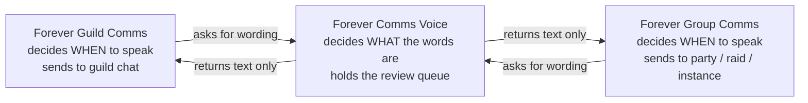

# Forever Comms Bundle

Three addons for **World of Warcraft: Forever** (client 1.60.1, Interface `16001`) by
Michael Reilly, developed in one repository and released as one download.

| Addon | Version | What it is |
| --- | --- | --- |
| **Forever Comms Voice** (`ForeverCommsVoice`) | 0.2.2-beta | Shared library. Owns all wording, the per-character language/accent profile, and the message review queue. Never sends anything. |
| **Forever Guild Comms** (`ForeverGuildComms`) | 0.6.3-beta | Guild social layer: greetings, welcomes, level congratulations, private alerts, tabard reminders, an Ask-for-Help composer. |
| **Forever Group Comms** (`ForeverGroupComms`) | 0.3.4-beta | Party, dungeon and raid layer: greetings, coordination calls, ready checks, target marks, quest comparison. |

Both applications declare `## Dependencies: ForeverCommsVoice` and **will not load without
it**. The library depends on nothing.

## Start here

- **[Installation](Installation)** — installing, updating, and what happens to your settings.
- **[Slash Commands and Keybindings](Slash-Commands-and-Keybindings)** — every command in one table.
- **[Settings Reference](Settings-Reference)** — every option, its default, and where it is saved.
- **[Troubleshooting](Troubleshooting)** — when something does not happen that you expected.

## Module documentation

Each addon is a set of Lua files loaded in a fixed order. There is no module system: the
files share one table per addon, and the order in the `.toc` is the order they load. The
pages below document what each file is responsible for, in the order it loads.

- **[ForeverCommsVoice modules](ForeverCommsVoice-Modules)** — 9 files: wording data, the render pipeline, the review queue.
- **[ForeverGuildComms modules](ForeverGuildComms-Modules)** — 9 files plus `Bindings.xml`.
- **[ForeverGroupComms modules](ForeverGroupComms-Modules)** — 7 files plus `Bindings.xml`.

## How the three fit together

**Text alternative:** both applications ask the library for the text of a message and then
decide for themselves whether, when and where to deliver it. The library renders strings
and holds the shared review queue. It registers no chat events and calls no send function.

That split is the whole design, and it is also a safety boundary. Because delivery never
moves into the library, there is exactly one place per addon that can put text into a
social channel, and every guard — the duplicate check, the self-exclusion check, the
spacing floor — lives on that path.

## What the bundle deliberately does not do

These are product decisions, not gaps:

- **No automation of your character.** Nothing equips or unequips gear, accepts or
  declines an invite, whispers anyone, queues for content, accepts or abandons a quest, or
  changes anyone's role. The tabard reminder opens your character panel. Quest sharing asks
  the game's own share function after you click. Ready checks and target marks need rank
  and an explicit trigger.
- **No congratulations for your own level-up.** Both addons exclude you by GUID and by
  name before any greeting or congratulation.
- **No rewriting of what you type.** The language and accent layer applies to
  addon-generated messages only. Your own chat, other addons' messages, and any template
  you edit yourself pass through untouched.
- **No machine translation.** The eight languages are hand-written offline tables.
- **No hard third-party dependencies.** Titan Panel and LibDataBroker are probed at
  runtime and both addons work fully without them. Nothing is bundled from elsewhere.
- **No combat, DPS, threat or encounter tracking.** The Forever client does not expose the
  data and it is not what this bundle is for.
